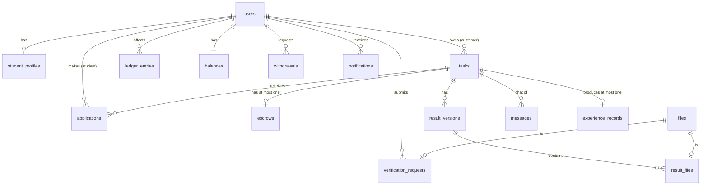

# CtoC: Data Model

For whoever writes the database schema.

| Decision | Source |
|---|---|
| Database: SQLite through `better-sqlite3`, schema and migrations in Drizzle | ADR-0004 |
| Constraints in the DB, conditional updates in transactions | ADR-0007 |
| Rules behind the columns | [`domain-model.md`](domain-model.md), cited as INV-xx |

## Conventions

| Topic | Rule |
|---|---|
| Ids | `TEXT` UUIDs generated in code. |
| Money | `INTEGER` kopecks. Never `REAL`. |
| Timestamps | `INTEGER` milliseconds since epoch (UTC). Column names end in `_at`. |
| Enums | `TEXT` with `CHECK (col IN (...))`. The values match `packages/shared` enums. |
| Booleans | `INTEGER` 0/1. |
| Foreign keys | Enabled with `PRAGMA foreign_keys = ON`. `ON DELETE RESTRICT` unless stated. Nothing financial is ever deleted. |
| Text lengths | `CHECK (length(col) BETWEEN a AND b)` mirrors the Zod schema. Zod gives the friendly error, the CHECK is the safety net. |
| Partial indexes | SQLite supports `CREATE UNIQUE INDEX … WHERE …`. They are used below for "at most one X in state Y". |

---

## 1. Tables

### Identity

**`users`**

| Column | Type | Constraints |
|---|---|---|
| id | TEXT | PK |
| email | TEXT | NOT NULL, `UNIQUE COLLATE NOCASE` (INV-01) |
| password_hash | TEXT | NOT NULL |
| display_name | TEXT | NOT NULL, CHECK length 2–60 |
| role | TEXT | NOT NULL, CHECK IN (`student`,`customer`,`moderator`) |
| email_confirmed_at | INTEGER | NULL |
| student_verified_at | INTEGER | NULL. CHECK (`student_verified_at IS NULL OR role='student'`). |
| created_at | INTEGER | NOT NULL |

**`sessions`**

| Column | Type | Constraints |
|---|---|---|
| id | TEXT | PK (random, 32 bytes) |
| user_id | TEXT | FK users, ON DELETE CASCADE |
| expires_at | INTEGER | NOT NULL |
| created_at | INTEGER | NOT NULL |

Indexes: `(user_id)`, `(expires_at)` for cleanup.

**`email_tokens`**

| Column | Type | Constraints |
|---|---|---|
| id | TEXT | PK |
| user_id | TEXT | FK users |
| purpose | TEXT | CHECK IN (`confirm_email`,`reset_password`) |
| token_hash | TEXT | NOT NULL, UNIQUE |
| expires_at | INTEGER | NOT NULL |
| used_at | INTEGER | NULL |
| created_at | INTEGER | NOT NULL |

Index: `(user_id, purpose)`.

**`university_domains`**

| Column | Type | Constraints |
|---|---|---|
| domain | TEXT | PK, `COLLATE NOCASE` |
| created_at | INTEGER | NOT NULL |

### Profile and verification

**`student_profiles`**

| Column | Type | Constraints |
|---|---|---|
| user_id | TEXT | PK, FK users |
| bio | TEXT | NOT NULL DEFAULT '', CHECK length ≤ 500 |
| updated_at | INTEGER | NOT NULL |

**`skills`**

| Column | Type | Constraints |
|---|---|---|
| id | TEXT | PK |
| name | TEXT | NOT NULL, `UNIQUE COLLATE NOCASE`, CHECK length 1–40 |
| in_catalog | INTEGER | NOT NULL DEFAULT 0 |

**`profile_skills`**

| Column | Type | Constraints |
|---|---|---|
| user_id | TEXT | FK users |
| skill_id | TEXT | FK skills |

Primary key: `(user_id, skill_id)`.

**`files`**

| Column | Type | Constraints |
|---|---|---|
| id | TEXT | PK |
| owner_id | TEXT | FK users |
| kind | TEXT | CHECK IN (`student_document`,`result`) |
| storage_key | TEXT | NOT NULL, UNIQUE |
| original_name | TEXT | NOT NULL |
| mime | TEXT | NOT NULL (detected by content) |
| size_bytes | INTEGER | NOT NULL, CHECK > 0 |
| sha256 | TEXT | NOT NULL |
| created_at | INTEGER | NOT NULL |
| deleted_at | INTEGER | NULL |

Index: `(owner_id)`.

**`verification_requests`**

| Column | Type | Constraints |
|---|---|---|
| id | TEXT | PK |
| user_id | TEXT | FK users |
| file_id | TEXT | FK files |
| status | TEXT | CHECK IN (`pending`,`approved`,`rejected`,`revoked`) |
| reason | TEXT | NULL. CHECK (`status<>'rejected' OR length(reason) BETWEEN 1 AND 500`). |
| decided_by | TEXT | FK users, NULL |
| decided_at | INTEGER | NULL |
| created_at | INTEGER | NOT NULL |

Indexes:
- `UNIQUE (user_id) WHERE status='pending'` (INV-04);
- `(status, created_at)` for the moderation queue.

### Tasks and applications

**`tasks`**

| Column | Type | Constraints |
|---|---|---|
| id | TEXT | PK |
| customer_id | TEXT | FK users, NOT NULL |
| title | TEXT | NOT NULL, CHECK length 5–120 |
| description | TEXT | NOT NULL, CHECK length 1–5000 |
| price_kopecks | INTEGER | NOT NULL, CHECK > 0 (INV-07) |
| deadline_at | INTEGER | NOT NULL |
| status | TEXT | NOT NULL, CHECK IN (`pending_moderation`,`published`,`rejected`,`in_progress`,`in_review`,`revision`,`done`,`cancelled`) |
| commission_bp | INTEGER | NULL until published |
| commission_kopecks | INTEGER | NULL until published |
| net_kopecks | INTEGER | NULL until published |
| executor_id | TEXT | FK users, NULL |
| moderation_reason | TEXT | NULL |
| published_at, assigned_at, completed_at, cancelled_at | INTEGER | NULL |
| created_at, updated_at | INTEGER | NOT NULL |

Table-level CHECKs:
- `commission_kopecks + net_kopecks = price_kopecks` when not NULL (INV-08);
- `status NOT IN ('in_progress','in_review','revision','done') OR executor_id IS NOT NULL`;
- `status = 'pending_moderation' OR commission_bp IS NOT NULL OR status IN ('rejected','cancelled')`.

Indexes:
- `(status, published_at DESC)` for the feed and the moderation queue;
- `(customer_id, created_at DESC)`;
- `(executor_id, status)`.

**`applications`**

| Column | Type | Constraints |
|---|---|---|
| id | TEXT | PK |
| task_id | TEXT | FK tasks |
| student_id | TEXT | FK users |
| note | TEXT | NULL, CHECK length ≤ 500 |
| status | TEXT | CHECK IN (`sent`,`accepted`,`rejected`) |
| created_at | INTEGER | NOT NULL |
| decided_at | INTEGER | NULL |

Indexes:
- `UNIQUE (task_id, student_id)` (INV-09);
- `UNIQUE (task_id) WHERE status='accepted'` (INV-10);
- `(student_id, created_at DESC)` for "Мої відгуки".

### Delivery

**`result_versions`**

| Column | Type | Constraints |
|---|---|---|
| id | TEXT | PK |
| task_id | TEXT | FK tasks |
| version | INTEGER | NOT NULL, CHECK ≥ 1 |
| status | TEXT | CHECK IN (`draft`,`submitted`,`accepted`,`returned`) |
| revision_comment | TEXT | NULL. CHECK (`status<>'returned' OR length(revision_comment) BETWEEN 1 AND 2000`). |
| submitted_at, decided_at | INTEGER | NULL |
| created_at | INTEGER | NOT NULL |

Indexes:
- `UNIQUE (task_id, version)`;
- `UNIQUE (task_id) WHERE status IN ('draft','submitted')`, so at most one open version per task.

**`result_files`**

| Column | Type | Constraints |
|---|---|---|
| result_version_id | TEXT | FK result_versions |
| file_id | TEXT | FK files, UNIQUE |

Primary key: `(result_version_id, file_id)`.

### Communication

**`messages`**

| Column | Type | Constraints |
|---|---|---|
| id | TEXT | PK (sortable, UUIDv7) |
| task_id | TEXT | FK tasks |
| sender_id | TEXT | FK users |
| body | TEXT | NOT NULL, CHECK length 1–2000 |
| created_at | INTEGER | NOT NULL |

Index: `(task_id, id)` for `?after=` polling.

**`notifications`**

| Column | Type | Constraints |
|---|---|---|
| id | TEXT | PK (UUIDv7) |
| user_id | TEXT | FK users |
| type | TEXT | NOT NULL, CHECK IN (the notification types in domain-model) |
| payload_json | TEXT | NOT NULL |
| read_at | INTEGER | NULL |
| created_at | INTEGER | NOT NULL |

Indexes: `(user_id, id)`, `(user_id) WHERE read_at IS NULL`.

### Money

**`escrows`**

| Column | Type | Constraints |
|---|---|---|
| id | TEXT | PK |
| task_id | TEXT | FK tasks, **UNIQUE** (INV-12) |
| customer_id | TEXT | FK users |
| amount_kopecks | INTEGER | NOT NULL, CHECK > 0 |
| status | TEXT | CHECK IN (`held`,`released`,`refunded`) |
| idempotency_key | TEXT | NOT NULL, UNIQUE |
| created_at | INTEGER | NOT NULL |
| settled_at | INTEGER | NULL |

**`balances`**

| Column | Type | Constraints |
|---|---|---|
| owner_id | TEXT | PK. A user id, or the literal `platform` for commission income. |
| available_kopecks | INTEGER | NOT NULL DEFAULT 0, **CHECK ≥ 0** (INV-20) |
| updated_at | INTEGER | NOT NULL |

**`ledger_entries`** (append-only)

| Column | Type | Constraints |
|---|---|---|
| id | TEXT | PK |
| owner_id | TEXT | NOT NULL (the balance it affects) |
| kind | TEXT | CHECK IN (`topup`,`hold`,`refund`,`payout`,`commission`,`withdrawal`,`withdrawal_reversal`) |
| amount_kopecks | INTEGER | NOT NULL, CHECK ≠ 0 (signed) |
| task_id | TEXT | FK tasks, NULL |
| withdrawal_id | TEXT | FK withdrawals, NULL |
| created_at | INTEGER | NOT NULL |

Indexes:
- `UNIQUE (task_id, kind) WHERE task_id IS NOT NULL`: one hold, refund, payout and commission per task (INV-12, INV-19);
- `UNIQUE (withdrawal_id, kind) WHERE withdrawal_id IS NOT NULL`;
- `(owner_id, created_at)`.

**`withdrawals`**

| Column | Type | Constraints |
|---|---|---|
| id | TEXT | PK |
| student_id | TEXT | FK users |
| amount_kopecks | INTEGER | NOT NULL, CHECK > 0 |
| card_number | TEXT | NULL (cleared when processed) |
| card_last4 | TEXT | NOT NULL, CHECK length = 4 |
| status | TEXT | CHECK IN (`requested`,`paid`,`rejected`) |
| processed_by | TEXT | FK users, NULL |
| processed_at | INTEGER | NULL |
| reason | TEXT | NULL |
| created_at | INTEGER | NOT NULL |

Table-level CHECK: `status = 'requested' OR card_number IS NULL`, so full card numbers never outlive processing.

Index: `(status, created_at)`.

### Experience, settings, audit

**`experience_records`**

| Column | Type | Constraints |
|---|---|---|
| id | TEXT | PK |
| student_id | TEXT | FK users |
| task_id | TEXT | FK tasks, **UNIQUE** (INV-21) |
| title | TEXT | NOT NULL |
| description | TEXT | NOT NULL |
| completed_at | INTEGER | NOT NULL |
| created_at | INTEGER | NOT NULL |

Index: `(student_id, completed_at DESC)` for "newest first" (US-37/S3).

**`settings`**

| Column | Type | Constraints |
|---|---|---|
| key | TEXT | PK, CHECK IN (`commission_bp`,`min_price_kopecks`,`max_price_kopecks`) |
| value | INTEGER | NOT NULL |
| updated_by | TEXT | FK users, NULL |
| updated_at | INTEGER | NOT NULL |

**`audit_events`** (append-only)

| Column | Type | Constraints |
|---|---|---|
| id | TEXT | PK |
| actor_id | TEXT | FK users, NULL |
| action | TEXT | NOT NULL |
| entity | TEXT | NOT NULL |
| entity_id | TEXT | NOT NULL |
| data_json | TEXT | NOT NULL |
| created_at | INTEGER | NOT NULL |

Index: `(entity, entity_id)`. Written by moderator decisions, settings changes, manual resolution and withdrawal processing (NFR-15).

### Entity relationship sketch

---

## 2. What the schema does enforce

| Invariant | How |
|---|---|
| INV-01 | `users.email` UNIQUE NOCASE |
| INV-04 | Partial unique index on pending verification requests |
| INV-07 (part) | `price_kopecks > 0` |
| INV-08 | CHECK `commission + net = price` |
| INV-09 | `UNIQUE (task_id, student_id)` |
| INV-10 (part) | Partial unique index on accepted applications |
| INV-12 | `escrows.task_id` UNIQUE, `idempotency_key` UNIQUE, ledger `(task_id, kind)` |
| INV-19 | Ledger `(task_id, 'payout')` unique |
| INV-20 (part) | `balances.available_kopecks >= 0` |
| INV-21 (part) | `experience_records.task_id` UNIQUE |
| Card retention | CHECK on `withdrawals` |
| Length limits | CHECKs that mirror the Zod schemas |

## 3. Invariants that live in transaction code

The schema cannot express these. Each one is implemented in the named module's `service.ts` as one synchronous transaction (ADR-0007) and covered by a test named after the invariant.

| Invariant | Why the schema cannot hold it | Implementation in the transaction |
|---|---|---|
| **Legal state transitions** (domain-model §3, INV-17, INV-24) | A CHECK sees one row version, not the transition from old to new. | `UPDATE … SET status=:to WHERE id=:id AND status IN (:allowedFrom)`. If 0 rows changed, return 409 `INVALID_TRANSITION` or a specific code. |
| **INV-05**: a new task always starts in `pending_moderation` | The column could hold any allowed value. | The service ignores client input and inserts `pending_moderation`. |
| **INV-02, INV-14, INV-22, INV-25**: who may act | Permissions depend on the session user and the relationship to the task. | `policy.ts` checks before the transaction, and re-checks owner and executor in the `WHERE` clause. |
| **INV-03**: badge only through approval | The column is just a timestamp. | Only `verification.approve()` sets `student_verified_at`, in the same transaction as `status='approved'`. |
| **INV-06**: feed contents | It is a query rule. | The feed query filters `status='published' AND executor_id IS NULL AND deadline_at > now`. |
| **INV-07**: price within configured limits, never changes | The limits live in `settings` and change at runtime. | Checked on insert. No update path for price exists. |
| **INV-08**: rate snapshotted at publication | The schema only checks the sum. | `publish()` reads `settings.commission_bp` and writes bp, commission and net in the same transaction. |
| **INV-10, INV-11**: one executor, plus escrow, plus reject others, plus notify | Spans 4 tables. | One transaction: 1. `UPDATE tasks … WHERE status='published' AND executor_id IS NULL` (0 rows → `TASK_ALREADY_ASSIGNED`) 2. debit the customer balance (conditional, 0 rows → `INSUFFICIENT_FUNDS`, roll back) 3. insert the escrow and the `hold` ledger entry 4. mark the chosen application `accepted` and the others `rejected` 5. insert the notification |
| Escrow amount equals the task price | Cross-table equality. | Copied from `tasks.price_kopecks` in the same transaction. |
| **INV-13**: no delete with an executor | It is a conditional action. | `UPDATE tasks SET status='cancelled' WHERE … AND executor_id IS NULL`. |
| **INV-15**: submit needs at least one file. **INV-16**: files locked | Counting child rows and checking the parent's status is not possible in a CHECK. | `submit()` counts `result_files` for the open version. File insert and delete check `status='draft'` on the version. |
| **INV-18**: acceptance is atomic | Spans 6 tables. | One transaction: task `done`, version `accepted`, escrow `released`, `payout` and `commission` entries and balance updates, experience record, notification. |
| **INV-20**: balance equals the sum of the ledger | An aggregate. | Every balance change writes a ledger entry in the same transaction. `npm run check:invariants` compares the totals. |
| **INV-23**: notification only on commit | Ordering. | Notifications are rows inserted inside the business transaction, never sent before commit. |
| Max 20 skills per profile | A count. | `setSkills()` replaces the set in one transaction and rejects more than 20. |
| A resend invalidates older tokens | Cross-row. | `resend()` sets `used_at` on the user's open tokens, then inserts a new one. |
| Withdrawal amount ≤ balance | The CHECK ≥ 0 is the safety net. A friendly error needs code. | `UPDATE balances SET available = available - :a WHERE owner_id=:u AND available >= :a`. 0 rows → `INSUFFICIENT_BALANCE`. |

## 4. Seed data (for the demo, ADR-0009)

On an empty database:
- 1 moderator;
- 2 customers with a sandbox balance;
- 3 verified students with skills and a bio, and 1 student with a pending document;
- the university domain list;
- about 8 tasks covering every status;
- settings: `commission_bp=1000`, `min_price_kopecks=5000`, `max_price_kopecks=2000000`.
