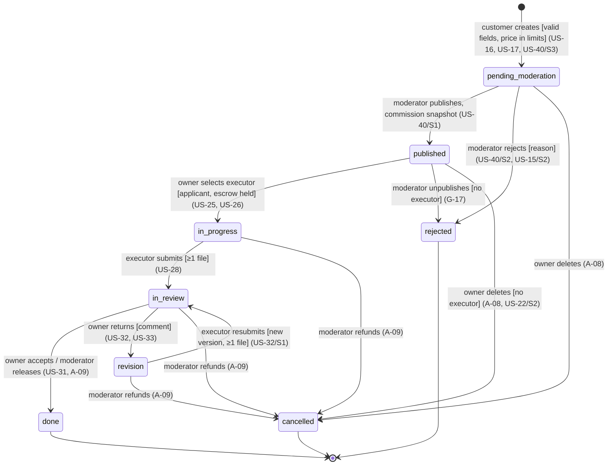
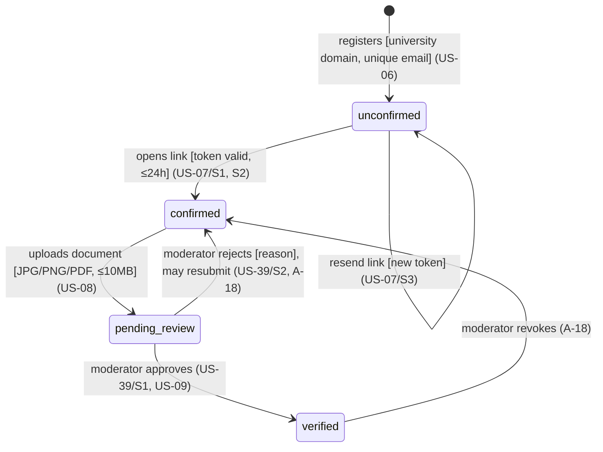
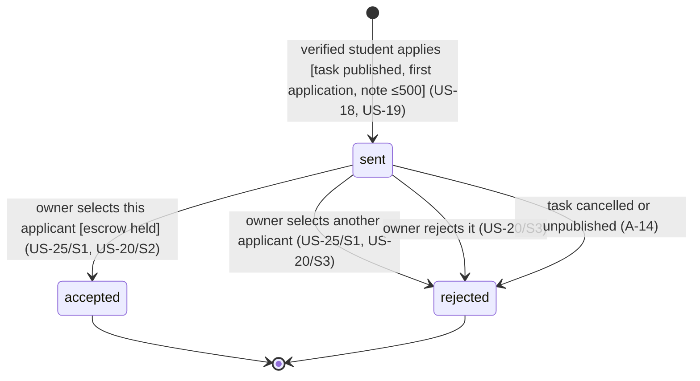

# CtoC: Domain Model

For everyone who writes code or tests. It lists:
- entities and their attributes with constraints;
- invariants;
- state machines for the **Task**, **Student role** and **Application** (the brief's Project, Role, Application; see overview OQ-01).

The tables behind this model are in [`data-model.md`](data-model.md). The HTTP contract is in [`api.md`](api.md).

**Where each constraint comes from**

| Tag | Meaning |
|---|---|
| `[AC]` | Stated in an acceptance criterion. |
| `[ex]` | An "наприклад" ("for example") value from an AC, adopted for the MVP (digest A-11). |
| `[prop]` | Proposed by the design because the requirements give no value (overview OQ-17). |
| `[ADR]` | Decided in an ADR. |

**Money** is always an integer number of **kopecks** (1 UAH = 100) [ADR-0007]. **Timestamps** are UTC and shown in the user's local time zone (US-22/S3).

---

## 1. Entities and attributes

### User (account)

| Attribute | Constraint | Source |
|---|---|---|
| `email` | Required. Unique, case-insensitive, stored lowercase. | US-06/S3 [AC] |
| | For `student`: the domain must be on the university allow-list. Error «Дозволено реєстрацію лише з використанням університетської електронної пошти». | US-06/CL, US-06/S2 [AC] |
| | For `customer`: any domain. | A-01, ADR-0006 |
| `password` | Required. Min 8 characters. Stored only as a bcrypt hash. | US-06/S1; length [prop] |
| `displayName` | Required, 2–60 characters, Unicode. Shown to other users. The email is never shown. | US-44 [AC]; bounds from the AC |
| `role` | `student` \| `customer` \| `moderator`. Set once. `moderator` is never self-registered. | ADR-0006, A-02, A-03 |
| `emailConfirmedAt` | Null until confirmed. Null means status «Непідтверджений». | US-06/S1, US-07/CL |
| `studentVerifiedAt` | Null unless an approved verification exists. Equals the requirements' «Студент» role and the «верифікований студент» badge. | US-08/CL, US-09/CL, overview OQ-05 |

### Email token

| Attribute | Constraint | Source |
|---|---|---|
| `token` | At least 32 random bytes. Only a hash is stored. Single use. | US-07/CL "унікальний токен"; [ADR-0006] |
| `expiresAt` | Created at + 24 h. | US-07/CL [ex] |
| `purpose` | `confirm_email` (`reset_password` is reserved). | US-07, OQ-11 |

A resend creates a new token and invalidates older unused ones (US-07/S3; invalidation [prop]).

### Verification request (student status document)

| Attribute | Constraint | Source |
|---|---|---|
| `file` | JPG, PNG or PDF, detected by content. Max 10 MB. | US-08/S1, S2, S3 [AC/ex] |
| | Error «Файл занадто великий. Максимальний розмір — 10 МБ». | US-08/S3 [AC] |
| `status` | `pending` \| `approved` \| `rejected` \| `revoked`. Display label for `pending`: «Очікує перевірки». | US-08/S1 (digest C-03), A-18 |
| `reason` | Required when rejected, 1–500 characters. | US-39/S2 [AC]; length [prop] |
| `decidedBy`, `decidedAt` | Set on decision. | NFR-15 |

### Student profile

| Attribute | Constraint | Source |
|---|---|---|
| `skills` | 0–20 items. Each is 1–40 characters, trimmed and non-empty, case-insensitively unique per profile. Chosen from the catalogue or entered freely. | US-10/CL, US-10/S2, S3 [AC/ex]; length [prop] |
| `bio` («Про мене») | 0–500 characters, Unicode including emoji. | US-11/S1, S2, S3 [ex] |

### Task (= Project)

| Attribute | Constraint | Source |
|---|---|---|
| `title` | Required, 5–120 characters. A single character is rejected. | US-16/CL, US-16/S3 [AC]; bounds [prop] |
| `description` | Required, 1–5000 characters. | US-16/S2 [AC]; max [prop] |
| `price` | Integer kopecks. From 5 000 (50 UAH) to 2 000 000 (20 000 UAH). | US-17/S2 min [ex]; max [prop] |
| | Number only. Values of 0 or less are rejected. | US-17/S3, US-15/S2 [AC] |
| | Set only by the customer. | US-13, US-17, US-42 |
| `deadlineAt` | Required. Date and time. Must be in the future when created. | US-12/S2, US-16/CL, US-22/S3 [AC]; future [prop] (G-19) |
| `commissionBp` | Commission rate in basis points (1000 = 10%), copied from settings **at publication**. | US-15/S1, A-07, ADR-0007 |
| `commission`, `net` | Calculated at publication: `commission = round_half_up(price × bp / 10000)`, `net = price − commission`. | US-15, US-35/S1, S2 |
| `status` | See the state machine in §3.1. | |
| `executorId` | Null until assignment. At most one. | US-25/S2 |
| `moderationReason` | Required when a moderator rejects, 1–500 characters. | US-40/S2; length [prop] |

### Application (Відгук)

| Attribute | Constraint | Source |
|---|---|---|
| `note` | Optional, 0–500 characters. | US-19/S2, S3 [AC]; max [prop] |
| `status` | `sent` «Надіслано», `accepted` «Прийнято», `rejected` «Відхилено». | US-20 [AC] |
| price | **Does not exist.** A `price` sent in the request is ignored. | US-42/S1, S2, US-13/S2 |

### Escrow

| Attribute | Constraint | Source |
|---|---|---|
| `amount` | Equals `task.price` exactly. | US-26/CL |
| `status` | `held` \| `released` \| `refunded`. | US-26, US-31/S1, A-09 |
| `idempotencyKey` | Unique. A repeat returns the same escrow. | US-26/S3 |

### Result version (delivery)

| Attribute | Constraint | Source |
|---|---|---|
| `files` | 1–10 files per version, each ≤ 50 MB. | US-28/S2, US-27/S3 [ex]; count [prop] |
| | Blocked: `.exe .bat .cmd .com .scr .msi .ps1 .vbs` and executables detected by content. | US-27/S2 [AC] + [prop] (overview OQ-18) |
| `version` | 1, 2, 3, … per task. | US-32/S1 |
| `status` | `draft` \| `submitted` \| `accepted` \| `returned`. | US-28, US-29/S3, US-31, US-32 |
| `revisionComment` | Required when returned, 1–2000 characters. Error «Коментар до доопрацювання є обов'язковим». | US-33/CL, US-33/S2, S3 [AC]; max [prop] |

### Chat message

| Attribute | Constraint | Source |
|---|---|---|
| `body` | 1–2000 characters after trimming. | US-23/S2 [AC]; max [prop] |
| sender | The task owner or the executor only. | US-23/CL, US-23/S3 |

### Notification

| Attribute | Constraint | Source |
|---|---|---|
| `type` | Stated in requirements: `executor_selected`, `result_accepted`, `verification_rejected`. | US-21, US-30, US-39/S2 |
| | To the customer: `application_received`, `result_submitted`, `task_published`, `task_rejected` (with the moderator's reason). | US-47, US-48, US-49 |
| | Proposed, no story yet: `verification_approved`, `result_returned`, `withdrawal_processed`. | A-15 |
| `readAt` | Null means unread. | US-21/S3, US-30/S3 |
| text | Stated in requirements: «Вас обрано виконавцем завдання [Назва]» and «Ваш результат прийнято замовником! Оплату нараховано». | US-21/S1, US-30/S1 |

### Balance, ledger entry, withdrawal

| Attribute | Constraint | Source |
|---|---|---|
| `balance.available` | ≥ 0. | US-36/S3 |
| `ledgerEntry.kind` | `topup` \| `hold` \| `refund` \| `payout` \| `commission` \| `withdrawal` \| `withdrawal_reversal`. Signed amount. Append-only. | ADR-0007 |
| `withdrawal.amount` | > 0 and ≤ available balance. Error «Недостатньо коштів на балансі для виведення». | US-36/S3 [AC] |
| `withdrawal.cardNumber` | 16 digits with a valid Luhn checksum. Kept only until processed, then only the last 4 digits remain. | US-36/S2 [AC] (overview OQ-13), A-10 |
| `withdrawal.status` | `requested` \| `paid` \| `rejected`. | A-10 (overview OQ-10) |

### Experience record

| Attribute | Constraint | Source |
|---|---|---|
| `title`, `description` | Copied from the task when it completes. | US-37/CL, US-37/S1 (overview OQ-14) |
| `completedAt` | The task's completion time. | US-37/S1 |
| marker | Always «Підтверджено платформою CtoC». Nobody can edit it. | US-38/CL |

### Settings

| Setting | Constraint | Source |
|---|---|---|
| `commissionBp` | 0–5000. Default 1000 (10%). Changed by a moderator. Read without caching. | US-03/S3, US-15/S1 [ex] |
| `minPrice`, `maxPrice` | Defaults 5 000 and 2 000 000 kopecks. | US-17 |
| University domains | Editable list. | A-17 |

---

## 2. Invariants

Each invariant has an id, so tests can name it. **DB** means the database schema enforces it. **TX** means transaction code enforces it (see `data-model.md` §3).

| ID | Invariant | Enforced by | Source |
|---|---|---|---|
| INV-01 | An email belongs to at most one account. | DB | US-06/S3 |
| INV-02 | Only a confirmed student can submit a document. Only a verified student can apply or withdraw. Any student with a confirmed email can read the feed and task details (decision OQ-19). | TX (policy) | US-08/S1, US-18/S3, US-12/CL |
| INV-03 | `studentVerifiedAt` is set only by a moderator approving a pending request. The badge is derived from it and nothing else. | TX | US-08/CL, US-09/CL, US-09/S2 |
| INV-04 | A user has at most one `pending` verification request. | DB | US-08 [prop] |
| INV-05 | A new task is always created as `pending_moderation`, whatever the client sends. | TX | US-40/S3 |
| INV-06 | Only `published` tasks appear in the feed. Feed tasks also have no executor and a future deadline. | TX (query) | US-14/CL, US-12/S2, A-13 |
| INV-07 | `price` > 0 and within the configured limits. The price never changes after creation. | DB (> 0) + TX | US-15/S2, US-17, A-21 |
| INV-08 | `commission + net = price` exactly, using the rate snapshotted at publication. | DB (CHECK) + TX | US-15/S1, US-35/S2, A-07 |
| INV-09 | At most one application per (student, task). | DB | US-18/S2 |
| INV-10 | At most one `accepted` application per task. It belongs to the task's executor. | DB + TX | US-25/S2 |
| INV-11 | Selecting an executor, holding escrow for the full price, rejecting all other `sent` applications, and notifying the student happen together or not at all. | TX | US-25/S1, US-26/S2, US-21/S2 |
| INV-12 | At most one escrow per task. A repeated reservation does not charge again. | DB | US-26/S3 |
| INV-13 | A task with an executor cannot be deleted. | TX | US-22/S2 |
| INV-14 | Only the executor can upload or submit results. Only the owner can accept or return. Others get 403. | TX (policy) | US-31/S2, US-27 |
| INV-15 | A submission needs at least one file. A task in `in_review` cannot be submitted again. | TX | US-28/S2, S3 |
| INV-16 | The files of a `submitted` or `accepted` version cannot be changed or deleted. | TX | US-29/S3 |
| INV-17 | Return for revision is only possible from `in_review` and needs a comment. `done` is final. | TX | US-32/CL, US-32/S2, US-33/S2 |
| INV-18 | On acceptance, these happen together or not at all: task `done`, escrow `released`, student credited with `net`, platform credited with `commission`, experience record created, notification sent. | TX | US-31/S1, US-34/S1, US-37/S1, US-30/S2 |
| INV-19 | At most one payout per task, even if the acceptance is repeated. | DB | US-34/S3 |
| INV-20 | Each balance equals the sum of its ledger entries, and is never negative. | DB (≥ 0) + TX + check script | US-36/S3, US-35/S2 |
| INV-21 | Experience records exist only for `done` tasks, at most one per task, and are never edited. | DB + TX | US-37/S2, US-38/CL |
| INV-22 | Chat is readable and writable only by the owner and the executor, from assignment onwards. It is read-only after `done` or `cancelled`. | TX (policy) | US-23/CL, US-23/S3, A-20 |
| INV-23 | Notifications are created inside the same transaction as the change they report. | TX | US-21/S2, US-30/S2 |
| INV-24 | A moderator decision applies only to an item still `pending` or `pending_moderation`. The first decision wins. | TX | US-39, US-40, NFR-18 |
| INV-25 | Only moderators reach `/api/mod/*`. | TX (policy) | US-39/S3 |

---

## 3. State machines

### 3.1 Task (= Project)

| State | Display label | Visible in the feed | Escrow |
|---|---|---|---|
| `pending_moderation` | «На модерації» (proposed, overview OQ-03) | no | none |
| `published` | «Опубліковано» | yes, while it has no executor and the deadline is in the future | none |
| `rejected` | «Відхилено» | never (US-14/S3) | none |
| `in_progress` | «В роботі» (proposed) | no | held |
| `in_review` | «На перевірці» | no | held |
| `revision` | «На доопрацюванні» | no | held |
| `done` | «Виконано» | no | released |
| `cancelled` | «Скасовано» (proposed) | no | refunded or none |

Forbidden, answered with 409:
- any transition out of `done`, `rejected` or `cancelled` (US-31/S3, US-32/S2);
- a second executor (US-25/S2);
- deleting the task after an executor is assigned (US-22/S2).

### 3.2 Student role (= Role)

Applies to `role=student` accounts. A customer account only has `unconfirmed → confirmed`.

| State | How it is derived | Can apply? | Badge |
|---|---|---|---|
| `unconfirmed` | `emailConfirmedAt IS NULL` | no | no |
| `confirmed` | Email confirmed, no approved or pending request | no (US-18/S3) | no (US-09/S2) |
| `pending_review` | Has a `pending` verification request | no | no |
| `verified` | `studentVerifiedAt IS NOT NULL` | yes | yes (US-09/S1, S3) |

Teachers and staff with a university email stop at `confirmed`, because their documents are rejected (US-08/S1, US-39/S1).

### 3.3 Application

If selection fails (for example, insufficient funds), the transaction rolls back and every application stays `sent` (US-21/S2, US-26/S2). Students cannot withdraw an application (A-14).

### 3.4 Secondary lifecycles (tables only)

| Entity | Transitions | Source |
|---|---|---|
| Escrow | (none) → `held` on selection. `held` → `released` on acceptance. `held` → `refunded` on moderator refund. | US-26, US-31, A-09 |
| Result version | (none) → `draft` (upload). `draft` → `submitted` (submit). `submitted` → `accepted` or `returned`. After `returned`, a new `draft` version can start. | US-27…US-33 |
| Withdrawal | (none) → `requested` (amount is debited). `requested` → `paid`. `requested` → `rejected` (amount is credited back). | US-36, A-10 |
| Notification | (none) → unread → read. | US-21/S3, US-30/S3 |
| Experience record | (none) → created. No other transitions. | US-37, US-38 |
