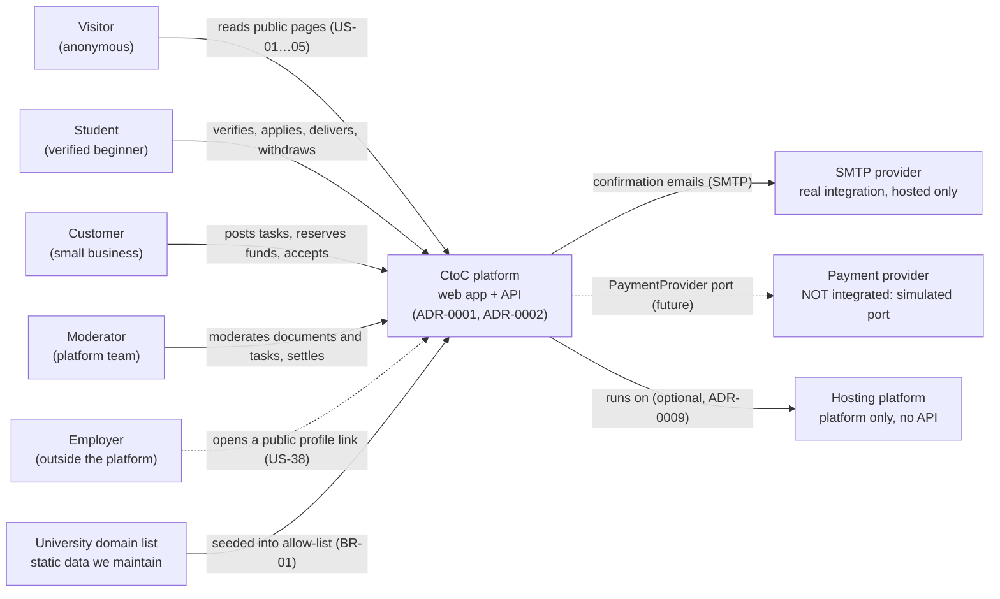
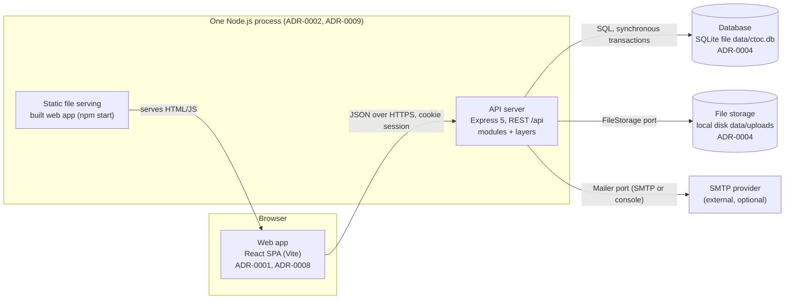

# CtoC: Technical Solution Overview

A 10-minute introduction for a new team member. Every decision here comes from an ADR in `docs/adr/` (cited as ADR-NNNN), and every requirement from `docs/analysis/requirements-digest.md` (BR-, NFR-, G-, A- ids) or `docs/requirements.md` (US-xx).

> **Naming note.** The design brief called the project "DevMatch" and asked for state machines for "Project, Role, Application". This repository is **CtoC**. The terms are mapped as follows:
> - **Project → Task.** The customer's micro-task.
> - **Role → Student role.** Granted through student-status verification. It is the only role that changes state.
> - **Application → Application** (Відгук).
>
> See Open question OQ-01.

Companion documents:
- [`domain-model.md`](domain-model.md): entities, constraints, invariants, state machines.
- [`api.md`](api.md): the HTTP contract and error codes.
- [`data-model.md`](data-model.md): tables, constraints, indexes.
- [`system.html`](system.html): the same system as one visual page.
- [`risks.md`](risks.md), [`integrations.md`](integrations.md).

---

## 1. What the system does, in one paragraph

CtoC is a micro-task marketplace for **beginner students only**.

1. A **customer** (small business) posts a task with a **fixed price** (no bidding).
2. A **moderator** publishes it after checking it is not homework.
3. **Verified students** apply.
4. The customer picks one executor and **reserves the full price** (simulated escrow in the MVP).
5. The student delivers files.
6. The customer accepts the result or returns it with a comment.
7. On acceptance, the student's balance is credited with the price minus commission, and the profile gets an immutable experience record «Підтверджено платформою CtoC».

---

## 2. C4 level 1: system context

### Real integrations versus links and formats

| External thing | What it is for us | Kind |
|---|---|---|
| SMTP provider | Sends confirmation emails, only on a hosted demo. Locally the email goes to the console and a dev outbox page (ADR-0006). | **Real integration** (SMTP), optional |
| Payment provider | Nothing in the MVP. `PaymentProvider` has a simulated implementation (ADR-0007). | **Not integrated.** An interface only. |
| Hosting platform | Runs one Node process (ADR-0009). We use only environment variables and `/healthz`. | **Platform**, no API calls |
| University domain list | Allowed email domains (BR-01). | **Static data** we maintain. No lookup. |
| Email confirmation link | A URL in our own email that points back to us (US-07). | **Link** |
| Public profile URL | A link a student shares with employers (US-38, A-16). | **Link** |
| Ukrainian bank card | Validated for format only (US-36/S2). There is no bank call. | **Format** |
| GitHub | Repository and CI only. No product integration. | **Dev tooling** |
| Telegram and other messengers | Out of scope for the MVP (`requirements.md` §2). | **Excluded** |

---

## 3. C4 level 2: containers

There are five containers: the browser SPA, the API, static serving inside the same process, the SQLite file, and the uploads folder. The shared package `packages/shared` is **code**, not a container. It is compiled into both the web app and the API (ADR-0003).

### Components of the Web app (`apps/web`)

| Component | Responsibility |
|---|---|
| `app/` (router, layout, guards) | Maps URLs to pages and redirects by login state and role (US-12/S3, ADR-0006). |
| `features/identity` | Register, login, confirm email, resend. Edit skills and bio. Render the public profile with the badge and experience. |
| `features/verification` | Upload a student document and show its status. |
| `features/tasks` | Feed, task card with gross and net price, customer task form, customer task list. |
| `features/applications` | Apply with a note. "Мої відгуки". Candidate list and executor selection. |
| `features/delivery` | Upload result files, submit, accept or return with a comment. |
| `features/chat` | Task chat with polling (ADR-0005). |
| `features/notifications` | Notification centre with unread state. |
| `features/payments` | Balance, payout breakdown, withdrawal form, sandbox top-up. |
| `features/experience` | Experience record list on profiles. |
| `features/admin` | Back-office pages: both moderation queues, withdrawals, settings. |
| `ui/` | Shared primitives: button, input, badge, status label, money. |
| `lib/api` | One fetch wrapper. Maps error `code` to Ukrainian text from `messages.uk.ts`. |

### Components of the API server (`apps/api`)

Every module has the same layers (ADR-0002): `routes.ts` → `policy.ts` → `service.ts` (owns the transaction) → `domain.ts` (pure state machine) → `repo.ts` (Drizzle).

| Module | Responsibility |
|---|---|
| `identity` | Accounts, passwords, sessions, email tokens, domain allow-list, profile (skills, bio, public read model) (US-06, US-07, US-10, US-11, US-24). |
| `verification` | Student documents and moderator decisions. Grants the student role and badge (US-08, US-09, US-39). |
| `tasks` | Task creation, moderation, feed, cancellation. Commission snapshot (US-12…17, US-40). |
| `applications` | Applications, executor selection with escrow (US-18…21, US-25, US-26). |
| `delivery` | Result versions and files, submit, accept, return (US-27…33). |
| `payments` | Escrow, ledger, balances, withdrawals, the `PaymentProvider` port (US-26, US-34…36). |
| `chat` | Messages between the owner and the executor of a task (US-23). |
| `notifications` | Creates notifications inside business transactions and lists them (US-21, US-30). |
| `experience` | Creates immutable experience records on acceptance (US-37, US-38). |
| `admin` | Settings (commission, price limits), manual deal resolution, withdrawal processing (US-03/S3, A-09, A-10). |

Cross-cutting platform code:

| Component | Responsibility |
|---|---|
| `platform/http` | Session middleware, origin check, rate limiting, `validate()`, upload middleware, the central error handler (ADR-0005, ADR-0006). |
| `platform/db` | SQLite connection, the `tx()` helper, migrations and seed on start (ADR-0003, ADR-0004). |
| `platform/ports` | `PaymentProvider` (simulated), `Mailer` (console or SMTP), `FileStorage` (local disk). |

### Shared package (`packages/shared`)

Holds the Zod schemas, status enums, `money` helpers (integer kopecks, commission rounding) and `messages.uk.ts` (the Ukrainian UI strings and error texts).

---

## 4. Frontend pages mapped to stories

**Access codes:**
- **P**: public.
- **A**: any logged-in user.
- **S-**: student with confirmed email.
- **S+**: verified student.
- **C**: customer.
- **M**: moderator.

| Route | Page | Access | Stories |
|---|---|---|---|
| `/` | Landing: beginners-only message, "Як це працює", commission | P | US-01, US-02, US-03 |
| `/payment-safety` | "Оплата та безпека" | P | US-04 |
| `/resume-info` | How experience records are confirmed, with an example | P | US-05 |
| `/terms` | Terms and current commission | P | US-03 |
| `/register` | Sign-up, choosing student or customer | P | US-06 (customer path: OQ-04) |
| `/login` | Login | P | US-09/S3 (OQ-11) |
| `/confirm-email` | Result of the confirmation link, resend | P | US-07 |
| `/u/:userId` | Public student profile: badge, skills, bio, experience | P | US-09, US-10, US-11, US-24, US-37, US-38 |
| `/me/profile` | Edit skills and bio | S- / S+ | US-10, US-11, US-38/S3 |
| `/me/verification` | Upload a student document and see its status | S- | US-08, US-39/S2 |
| `/feed` | Task feed | S- | US-12, US-13, US-14, US-15 |
| `/tasks/:id` | Task details and apply dialog with note. Applying needs S+. A non-verified student is prompted to verify. | S- (apply: S+) | US-13, US-15, US-18, US-19, US-42 |
| `/me/applications` | "Мої відгуки" with statuses | S- / S+ | US-20 |
| `/me/work` | "Мої активні завдання" | S+ | US-22, US-29 |
| `/work/:taskId` | Workspace: terms, chat, result upload and submit, revision comment | S+ (executor) | US-22, US-23, US-27, US-28, US-29, US-32, US-33 |
| `/me/finance` | Balance, per-task breakdown, withdrawal | S+ | US-34, US-35, US-36 |
| `/notifications` | Notification centre | A | US-21, US-30, US-39/S2 |
| `/c/tasks/new` | Task form | C | US-16, US-17 |
| `/c/tasks` | My tasks with statuses | C | none (OQ-07) |
| `/c/tasks/:id` | Task management: candidates, select and reserve, review result, chat | C (owner) | US-23, US-24, US-25, US-26, US-31, US-32, US-33 |
| `/c/balance` | Sandbox balance top-up | C | US-26 (OQ-09) |
| `/mod/verifications` | Student document queue | M | US-39, US-41 |
| `/mod/tasks` | Task moderation queue, deal resolution | M | US-40, US-14, US-15/S2 (resolution: OQ-08) |
| `/mod/withdrawals` | Withdrawal requests | M | none (OQ-10) |
| `/mod/settings` | Commission, price limits, university domains | M | US-03/S3 |

Every one of the 42 stories appears in at least one page row.

---

## 5. End-to-end scenario (happy path)

The user journey `J-1…J-7` from `requirements.md` §1, as pages, endpoints and state changes. Endpoints are defined in [`api.md`](api.md). States are defined in [`domain-model.md`](domain-model.md) §3.

| # | Actor | Page | Endpoints | Result | Stories |
|---|---|---|---|---|---|
| 1 | Visitor | `/`, `/payment-safety`, `/resume-info` | `GET /api/public/settings` | Sees the beginners-only message, the steps and the commission | US-01…US-05 |
| 2 | Student | `/register`, `/confirm-email` | `POST /api/auth/register`, `POST /api/auth/confirm-email` | Account `unconfirmed` → `confirmed` | US-06, US-07 |
| 3 | Student, Moderator | `/me/verification`, `/mod/verifications` | `POST /api/me/verification`, `POST /api/mod/verifications/:id/approve` | `pending_review` → `verified`. Badge shown. | US-08, US-39, US-09 |
| 4 | Student | `/me/profile` | `PUT /api/me/skills`, `PUT /api/me/profile` | Skills and bio on the public profile | US-10, US-11 |
| 5 | Customer, Moderator | `/c/tasks/new`, `/mod/tasks` | `POST /api/tasks`, `POST /api/mod/tasks/:id/publish` | Task `pending_moderation` → `published`. Commission snapshot. | US-16, US-17, US-40 |
| 6 | Student | `/feed`, `/tasks/:id` | `GET /api/tasks`, `POST /api/tasks/:id/applications` | Application `sent` | US-12…US-15, US-18, US-19 |
| 7 | Customer | `/c/tasks/:id` | `GET /api/tasks/:id/applications`, `POST /api/tasks/:id/assign` | Task `in_progress`, escrow `held`, application `accepted` (others `rejected`), notification sent | US-24, US-25, US-26, US-21 |
| 8 | Student, Customer | `/work/:taskId` | `POST /api/tasks/:id/messages`, `POST /api/tasks/:id/result/files`, `POST /api/tasks/:id/result/submit` | Task `in_review` | US-22, US-23, US-27, US-28, US-29 |
| 9 | Customer | `/c/tasks/:id` | `POST /api/tasks/:id/accept` (or `/return` → `revision`) | Task `done`, escrow `released`, payout and commission, experience record, notification | US-31, US-30, US-34, US-37, US-38 (US-32, US-33) |
| 10 | Student, Moderator | `/me/finance`, `/mod/withdrawals` | `POST /api/me/withdrawals`, `POST /api/mod/withdrawals/:id/mark-paid` | Withdrawal `requested` → `paid` | US-35, US-36 (A-10) |

## 6. How a request flows (example: customer accepts a result)

1. `/c/tasks/:id` calls `POST /api/tasks/:id/accept`.
2. Middleware checks the session and origin. `validate()` checks the body.
3. `delivery/policy.canAccept(user, task)` returns 403 for anyone other than the owner (US-31/S2).
4. `delivery/service.accept()` opens **one** transaction:
   - a conditional update of the task (`in_review` → `done`) and the result version;
   - `payments` credits the student's net amount, records the platform commission and releases the escrow;
   - `experience` creates the record;
   - `notifications` inserts «Ваш результат прийнято замовником! Оплату нараховано».
5. If any step fails, the transaction rolls back and nothing is notified (US-30/S2). If zero rows were updated, the response is 409 `TASK_NOT_IN_REVIEW` (US-31/S3).

---

## 7. Open questions

These are stories that are not covered, or that contradict each other or the design. **None of them is silently resolved.** Where the design had to proceed, it uses the assumption named in the third column, and that needs confirmation.

### 7.1 Decided by the product owner (2026-10-27)

| ID | Question | Decision | Applied in |
|---|---|---|---|
| OQ-01 | Project→Task and Role→student-role mapping | Naming only, no product impact. The owner asked what it meant. Treated as accepted by default. | overview naming note |
| OQ-04 | Customers sign up with any email | **Yes.** Confirmed by the same link flow. | ADR-0006, `api.md` register |
| OQ-06 | Ask for a display name at sign-up | **Yes.** 2–60 characters. | domain-model User |
| OQ-07 | Customer notifications and a "My tasks" page | **Yes.** Stories still to be written. | `/c/tasks`, `GET /api/my/tasks`, notification types |
| OQ-08 | Customer cancels after selecting an executor | **No.** The customer may delete only before selection. After it, only a moderator resolves (A-09). | domain-model §3.1 |
| OQ-11 | Login and logout stories | **Yes.** Password reset stays postponed. | `api.md` auth endpoints, ADR-0006 |
| OQ-12 | US-34/S2 and S3 gateway and webhook scenarios | **Replaced** by tests for the simulated payment provider. | `traceability.md` US-34 |
| OQ-19 | Feed visibility (was W-02): US-12 says verified students only, US-18/S3 has a non-verified student pressing «Відгукнутися» | **Variant B.** Any student with a confirmed email reads the feed and task details. Only applying needs verification. | `api.md`, overview §4, INV-02, ADR-0006, `traceability.md` |

### 7.2 Still open

| ID | Question | What the design does meanwhile |
|---|---|---|
| OQ-02 | **US-24/S2 contradicts US-18/S3.** US-24/S2 has a non-verified user who submitted an application; US-18/S3 blocks non-verified students from applying. | Follows US-18/S3. US-24/S2 can only happen if verification is revoked after applying (A-18). |
| OQ-03 | «На перевірці» labels two different task states (US-14/US-40 versus US-28/US-29). Which display labels should each use? | Separate internal states `pending_moderation` and `in_review` (ADR-0007). The UI label for moderation is proposed as «На модерації». |
| OQ-05 | US-08 says the «Студент» role is assigned after approval. Our account `role=student` is chosen at sign-up, and "verified" is a separate flag. Is this wording difference acceptable? | `role` is the account type. The requirements' «Студент» role equals `student_verified_at IS NOT NULL`. |
| OQ-09 | US-26/S1 reserves "зі свого балансу/картки" ("from their balance or card"), but there is no story for funding a customer balance. | A labelled sandbox top-up on `/c/balance` (A-06). |
| OQ-10 | US-36 ends at "a request is created". No story covers who pays it out or its statuses. | A moderator marks the request paid or rejected on `/mod/withdrawals` (A-10). |
| OQ-13 | US-36/S2 rejects cards of a "закордонного банку" ("foreign bank"). That needs issuer (BIN) data, which is external data. | Validates 16 digits and the Luhn checksum only. Foreign-issuer detection is open. |
| OQ-14 | US-37 title says "обсягом" ("volume") but the checklist says "описом" ("description") (digest C-05). The record would also publish the customer's task description on a public page (A-16). | Stores title, description and date. Customer confidentiality is not handled. |
| OQ-15 | US-41/S3 expects "technical rules" that make commercial contractors impossible. Only manual moderation exists (US-39). | Not technically enforceable. Relies on US-39. |
| OQ-16 | US-02/S2 and S3 describe a dynamically loaded "How it works" block. The design uses static content (A-23). | These scenarios become content checks, not runtime behaviour. |
| OQ-17 | Limits with no source value: maximum price, title minimum and maximum, description maximum, note, revision comment, message, rejection reason. | Proposed values are marked `[prop]` in `domain-model.md` (A-11). |
| OQ-18 | Result file types: the AC forbids only `.bat` and `.scr`, and US-08/S2 forbids `.zip` **for documents**. Should `.zip` be allowed for results (code deliverables)? | Block-list of executables for results, `.zip` allowed, archive contents not scanned. |
