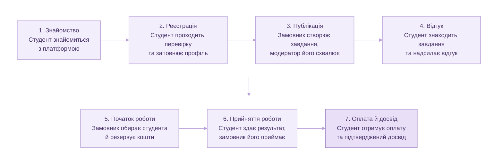

# Специфікація вимог та прийняття (MVP) — Фріланс-біржа "CtoC"

---

## 1. Головний шлях користувача (User Journey)

Цей покроковий ланцюжок описує класичний шлях («Happy Path») взаємодії користувачів на платформі «CtoC» — від першого знайомства з концепцією до отримання заробітку та верифікованого запису в резюме.

**Схема основного успішного сценарію:**

1. **Знайомство з платформою:**
   - Потенційний студент-початківець потрапляє на головну сторінку й бачить позиціонування платформи (виключно для початківців без агенцій і сеньйорів).
   - Знайомиться з інструкцією «Як це працює» (3–4 кроки), а також заздалегідь переглядає інформацію про комісію, безпечну оплату та майбутній підтверджений досвід у резюме.
2. **Реєстрація та верифікація:**
   - Користувач реєструється за допомогою університетської електронної пошти та підтверджує її через посилання в листі.
   - Завантажує студентський квиток для додаткової перевірки статусу.
   - Команда платформи вручну перевіряє документ, після чого студенту присвоюється роль і з'являється значок «верифікований студент».
   - Студент заповнює профіль (додає навички та коротку біографію).
3. **Публікація завдання замовником:**
   - Замовник створює завдання у простій формі (назва, опис, фіксована ціна та строк) і надсилає його на модерацію.
   - Член команди платформи перевіряє завдання (відсікаючи домашні завдання) та публікує його.
4. **Пошук та відгук на завдання:**
   - Верифікований студент переглядає стрічку мікрозавдань, де бачить фіксовану ціну, дедлайн та чисту суму до отримання (після вирахування комісії).
   - Студент натискає кнопку швидкого відгуку, додає коротку записку та надсилає його замовнику.
5. **Вибір виконавця та початок роботи:**
   - Замовник переглядає профілі кандидатів із відзнакою «верифікований студент», обирає найкращого та резервує кошти на платформі.
   - Студент отримує сповіщення про вибір і переходить до роботи в картці завдання із вбудованим чатом для уточнення деталей.
6. **Здача та прийняття результату:**
   - Студент завантажує готовий результат до картки завдання й надсилає його на перевірку (статус «На перевірці»).
   - Замовник перевіряє роботу і натискає «Прийняти результат» (або повертає на доопрацювання з коментарем).
7. **Оплата та підтвердження досвіду:**
   - Після прийняття результату замовником кошти автоматично зараховуються на баланс студента (з детальною розбивкою комісій), після чого він може вивести їх на українську банківську картку.
   - У профілі студента автоматично з'являється офіційний запис про виконане завдання з міткою «Підтверджено платформою CtoC».

---

## 2. Картка історій та межі скоупу

Загальний розподіл історій на In Scope (MVP) та Out of Scope.

### In Scope (MVP)
* **Епік 1. Знайомство з платформою:** US-01, US-02, US-03, US-04, US-05
* **Епік 2. Реєстрація, підтвердження статусу студента та профіль:** US-06, US-07, US-08, US-09, US-10, US-11
* **Епік 3. Пошук завдання:** US-12, US-13, US-14, US-15, US-16, US-17
* **Епік 4. Відгук на завдання та початок роботи:** US-18, US-19, US-20, US-21, US-22, US-23, US-24, US-25, US-26
* **Епік 5. Здача роботи та прийняття результату:** US-27, US-28, US-29, US-30, US-31, US-32, US-33
* **Епік 6. Отримання оплати та підтвердженого запису в резюме:** US-34, US-35, US-36, US-37, US-38
* **Епік 7. Межі продукту та довіра (Наскрізні):** US-39, US-40, US-41, US-42

### Out of Scope (поза межами MVP)
* Аукціонна система ставок (зниження/підвищення ціни студентами).
* Реєстрація та робота комерційних агенцій і досвідчених фрілансерів (сеньйорів).
* Автоматична верифікація студентських квитків за допомогою сторонніх освітніх API (тільки ручна модерація).
* Інтеграція зі сторонніми месенджерами (Telegram, Viber тощо) — спілкування виключно у внутрішньому чаті платформи.
* Багатомовність платформи (підтримка виключно української мови для MVP).

---

## 3. Специфікація історій у роботі (MVP)

Перелік фінальних, декомпозованих User Stories за шаблоном «Як [роль], я хочу [дія], щоб [цінність]»:

* **US-01:** Як студент-початківець, я хочу на головній сторінці одразу зрозуміти, що платформа створена лише для початківців без агенцій і сеньйорів, щоб швидко вирішити, чи варто мені тут реєструватися.
* **US-02:** Як студент-початківець, я хочу бачити пояснення, як працює платформа, у 3–4 простих кроках, щоб зрозуміти, що саме мені потрібно зробити для отримання першого завдання.
* **US-03:** Як студент-початківець, я хочу бачити розмір комісії платформи ще до реєстрації, щоб заздалегідь знати, яку частину оплати я збережу.
* **US-04:** Як студент-початківець, я хочу бачити, як відбувається оплата за виконане завдання, ще до реєстрації, щоб бути впевненим, що я отримаю гроші за свою роботу.
* **US-05:** Як студент-початківець, я хочу бачити, як підтверджується запис про досвід у резюме, ще до реєстрації, щоб оцінити, чи справді платформа дасть мені підтверджений досвід.
* **US-06:** Як студент-початківець, я хочу зареєструватися за допомогою університетської пошти, щоб підтвердити свою приналежність до закладу вищої освіти.
* **US-07:** Як студент-початківець, я хочу отримати лист із посиланням для підтвердження пошти, щоб підтвердити, що ця пошта належить мені.
* **US-08:** Як студент-початківець, я хочу додатково підтвердити свій статус студента (наприклад, за допомогою студентського квитка), щоб отримати роль студента, яку не отримують викладачі та співробітники.
* **US-09:** Як студент-початківець, я хочу отримати в профілі значок «верифікований студент», щоб замовники бачили, що я справжній студент, і охочіше довіряли мені завдання.
* **US-10:** Як студент-початківець, я хочу вказати в профілі свої навички, щоб замовники могли оцінити, чи підходжу я для їхнього завдання.
* **US-11:** Як студент-початківець, я хочу коротко розповісти про себе в профілі, щоб замовник міг скласти враження про мене до того, як обере виконавця.
* **US-12:** Як студент-початківець, я хочу бачити стрічку мікрозавдань з описом, ціною та строком виконання для кожного завдання, щоб обрати те, що мені під силу.
* **US-13:** Як студент-початківець, я хочу бачити фіксовану ціну, яку встановив замовник, щоб не конкурувати з іншими студентами за рахунок зниження ціни.
* **US-14:** Як студент-початківець, я хочу бачити у стрічці лише завдання, які пройшли перевірку командою, щоб не натрапити на домашні завдання під виглядом замовлень.
* **US-15:** Як студент-початківець, я хочу бачити в картці завдання суму, яку я отримаю після вирахування комісії, щоб заздалегідь знати свій реальний заробіток.
* **US-16:** Як замовник, я хочу опублікувати завдання у простій формі з мінімумом полів, щоб швидко знайти виконавця, не витрачаючи час на складне оформлення.
* **US-17:** Як замовник, я хочу самостійно встановити ціну завдання, щоб заздалегідь знати свої витрати й отримати результат у межах помірного бюджету.
* **US-18:** Як студент-початківець, я хочу відгукнутися на завдання одним натисканням, щоб без зайвих зусиль заявити про готовність взятися за роботу.
* **US-19:** Як студент-початківець, я хочу додати до відгуку коротку записку, щоб представити себе замовнику й підвищити шанс бути обраним.
* **US-20:** Як студент-початківець, я хочу бачити статус свого відгуку (надіслано, прийнято, відхилено), щоб не гадати, чи замовник вирішив щодо мене.
* **US-21:** Як студент-початківець, я хочу отримати сповіщення, коли замовник обрав мене виконавцем, щоб вчасно приступити до роботи.
* **US-22:** Як студент-початківець, я хочу бачити картку завдання з умовами, строком і ціною, щоб чітко розуміти, що від мене очікується.
* **US-23:** Як студент-початківець, я хочу спілкуватися із замовником у чаті на платформі, щоб уточнювати деталі завдання, не переходячи до сторонніх месенджерів.
* **US-24:** Як замовник, я хочу переглянути профіль студента зі значком верифікації, щоб оцінити його перед тим, як довірити завдання.
* **US-25:** Як замовник, я хочу обрати виконавця серед студентів, які відгукнулися на моє завдання, щоб доручити роботу тому, хто здається мені найбільш підходящим.
* **US-26:** Як замовник, я хочу зарезервувати кошти на платформі до початку роботи, щоб студент був певен, що оплата за виконане завдання гарантована.
* **US-27:** Як студент-початківець, я хочу завантажити готовий результат до картки завдання, щоб передати виконану роботу замовнику.
* **US-28:** Як студент-початківець, я хочу надіслати результат на перевірку замовнику, щоб він міг оцінити мою роботу й прийняти її.
* **US-29:** Як студент-початківець, я хочу бачити статус «на перевірці», щоб розуміти, що замовник уже отримав мій результат і мені лишається чекати рішення.
* **US-30:** Як студент-початківець, я хочу отримати сповіщення про прийняття результату, щоб знати, що завдання виконано успішно й оплату буде нараховано.
* **US-31:** Як замовник, я хочу прийняти результат, щоб підтвердити, що завдання виконано, і завершити угоду.
* **US-32:** Як замовник, я хочу повернути результат на доопрацювання, щоб отримати роботу, яка відповідає умовам завдання.
* **US-33:** Як замовник, я хочу додати коментар до повернення на доопрацювання, щоб студент розумів, що саме потрібно виправити.
* **US-34:** Як студент-початківець, я хочу отримати виплату після прийняття результату замовником, щоб отримати винагороду за виконану роботу.
* **US-35:** Як студент-початківець, я хочу бачити розбивку виплати (загальну суму, розмір комісії та суму до отримання), щоб розуміти, як формується моя винагорода.
* **US-36:** Як студент-початківець, я хочу вивести кошти на українську банківську картку, щоб мати змогу користуватися заробленими коштами.
* **US-37:** Як студент-початківець, я хочу отримати в профілі запис про виконане завдання з назвою, обсягом і датою, щоб мати документований досвід для резюме.
* **US-38:** Як студент-початківець, я хочу бачити, що запис про виконане завдання підтверджений платформою, а не доданий мною самостійно, щоб цей досвід викликав довіру в роботодавців.
* **US-39:** Як член команди платформи, я хочу вручну перевіряти підтвердження статусу студента, щоб роль студента отримували лише справжні студенти, а не викладачі чи співробітники закладу.
* **US-40:** Як член команди платформи, я хочу перевіряти кожне завдання перед його публікацією, щоб на платформу не потрапляли домашні завдання під виглядом замовлень.
* **US-41:** Як студент-початківець, я хочу, щоб серед виконавців на платформі не було агенцій і досвідчених спеціалістів, щоб не програвати їм у конкуренції за завдання.
* **US-42:** Як студент-початківець, я хочу, щоб я не міг пропонувати власну ціну за завдання, щоб оплата за роботу не знижувалася через змагання студентів між собою.

---

## 4. Критерії приймання (Acceptance Criteria)

### Епік 1. Знайомство з платформою

#### [US-01] Як студент-початківець, я хочу на головній сторінці одразу зрозуміти, що платформа створена лише для початківців без агенцій і сеньйорів, щоб швидко вирішити, чи варто мені тут реєструватися.
- **Чек-лист:**
  - Головна сторінка містить чіткий текстовий заклик або банер про те, що платформа орієнтована виключно на студентів-початківців.
  - Наявне явне обмеження/заборона на участь агенцій та досвідчених фахівців (сеньйорів).
  - Елементи інтерфейсу відображаються коректно на десктопних та мобільних пристроях.
- **Сценарії (Gherkin):**
  - Сценарій 1 (Happy Path):
    - Given неавторизований користувач відкриває головну сторінку платформи
    - When сторінка повністю завантажується
    - Then користувач бачить інформаційний блок із повідомленням, що платформа створена виключно для студентів-початківців без агенцій і сеньйорів
  - Сценарій 2 (Edge Case 1 - Відсутність ключового повідомлення умовою дизайну):
    - Given дизайн головної сторінки оновлюється
    - When користувач переглядає перший екран (above the fold)
    - Then обов'язково присутній текст або заголовок про обмеження для агенцій та сеньйорів
  - Сценарій 3 (Edge Case 2 - Доступ з мобільного пристрою):
    - Given користувач відкриває головну сторінку зі смартфона
    - When сторінка адаптується під мобільний екран
    - Then блок про орієнтацію платформи на початківців залишається видимим без необхідності глибокого скролу

#### [US-02] Як студент-початківець, я хочу бачити пояснення, як працює платформа, у 3–4 простих кроках, щоб зрозуміти, що саме мені потрібно зробити для отримання першого завдання.
- **Чек-лист:**
  - На головній сторінці присутній окремий блок «Як це працює».
  - Блок містить рівно 3 або 4 послідовні кроки з іконками та коротким описом.
  - Описи кроків відповідають логіці платформи (реєстрація, відгук, виконання, оплата).
- **Сценарії (Gherkin):**
  - Сценарій 1 (Happy Path):
    - Given відвідувач перебуває на головній сторінці
    - When він прокручує сторінку до розділу «Як це працює»
    - Then він бачить послідовність із 3-4 кроків, що пояснюють шлях від реєстрації до отримання завдання
  - Сценарій 2 (Edge Case 1 - Неповна кількість кроків):
    - Given система завантажує розділ інструкцій (якщо через збій чи помилку на екран виводиться менше 3 або більше 4 кроків)
    - When кількість сформованих кроків становить менше 3 або більше 4
    - Then інтерфейс блоку блокується або виводить дефолтну структуру з 3-4 кроками відповідно до вимог MVP
  - Сценарій 3 (Edge Case 2 - Відсутність текстового опису в кроці):
    - Given користувач переглядає покрокову інструкцію
    - When один із кроків не має текстового пояснення
    - Then система примусово відображає базовий шаблонний опис або приховує неповний крок

#### [US-03] Як студент-початківець, я хочу бачити розмір комісії платформи ще до реєстрації, щоб заздалегідь знати, яку частину оплати я збережу.
- **Чек-лист:**
  - Інформація про розмір комісії платформи чітко зазначена у відкритому доступі (на головній сторінці або в розділі FAQ/Умови).
  - Процентна ставка або фіксована сума комісії вказана цифрами без прихованих умов.
- **Сценарії (Gherkin):**
  - Сценарій 1 (Happy Path):
    - Given незареєстрований користувач переглядає головну сторінку або сторінку умов
    - When він шукає інформацію про комісійні збори
    - Then він бачить чітко вказаний розмір комісії платформи у відсотках або фіксованій сумі
  - Сценарій 2 (Edge Case 1 - Прихована інформація про комісію):
    - Given користувач намагається знайти інформацію про комісію
    - When розділ комісій відсутній у загальному доступі
    - Then система вважається такою, що не відповідає критеріям прийняття (помилка бізнес-вимоги)
  - Сценарій 3 (Edge Case 2 - Зміна розміру комісії адміністратором):
    - Given адміністратор змінює ставку комісії в бекофісі
    - When неавторизований користувач оновлює сторінку умов
    - Then на екрані відображається актуальне значення комісії без застарілого кешу

#### [US-04] Як студент-початківець, я хочу бачити, як відбувається оплата за виконане завдання, ще до реєстрації, щоб бути впевненим, що я отримаю гроші за свою роботу.
- **Чек-лист:**
  - Наявний публічний опис процесу гарантії та виплати коштів (резервування замовником -> виконання -> перевірка -> виплата).
  - Описано механізм безпечної угоди та виведення на банківську картку.
- **Сценарії (Gherkin):**
  - Сценарій 1 (Happy Path):
    - Given потенційний користувач читає інформацію на платформі до реєстрації
    - When він переходить до розділу «Оплата та безпека»
    - Then він бачить детальний опис процесу резервування коштів і подальшої виплати
  - Сценарій 2 (Edge Case 1 - Неоднозначність у гарантіях виплат):
    - Given в описі процесу оплати відсутні згадки про резервування коштів замовником
    - When QA-інженер перевіряє сторінку
    - Then фіксується дефект через порушення прозорості умов для студента
  - Сценарій 3 (Edge Case 2 - Доступність сторінки для мобільних браузерів):
    - Given користувач відкриває опис оплати зі смартфона
    - When текст складається з кількох блоків
    - Then блоки вирівнюються вертикально без горизонтального скролу чи накладання шрифтів

#### [US-05] Як студент-початківець, я хочу бачити, як підтверджується запис про досвід у резюме, ще до реєстрації, щоб оцінити, чи справді платформа дасть мені підтверджений досвід.
- **Чек-лист:**
  - Опубліковано пояснення того, що після успішного виконання завдання в профілі формується офіційний підтверджений запис.
  - Зазначено, що запис верифіковано платформою (не може бути редагований чи доданий вручну самим студентом).
- **Сценарії (Gherkin):**
  - Сценарій 1 (Happy Path):
    - Given незареєстрований користувач переглядає розділ про переваги платформи
    - When він відкриває інформацію про резюме та досвід
    - Then він бачить пояснення про автоматичне створення верифікованого платформою запису в резюме
  - Сценарій 2 (Edge Case 1 - Хибне тлумачення ручного додавання):
    - Given опис резюме на сайті містить твердження, що користувач сам додає проекти
    - When перевіряється відповідність бізнес-правилам
    - Then текст блокується, оскільки записи мають підтверджуватися платформою автоматично після виконання завдання
  - Сценарій 3 (Edge Case 2 - Наявність ілюстративних прикладів):
    - Given користувач переглядає розділ про резюме
    - When сторінка завантажується
    - Then наявний візуальний приклад того, як виглядатиме верифікований запис у майбутньому профілі

---

### Епік 2. Реєстрація, підтвердження статусу студента та профіль

#### [US-06] Як студент-початківець, я хочу зареєструватися за допомогою університетської пошти, щоб підтвердити свою приналежність до закладу вищої освіти.
- **Чек-лист:**
  - Форма реєстрації містить поле для введення електронної пошти.
  - Валідація пошти перевіряє наявність академічного домену (або система приймає вхідні пошти з університетських доменів згідно з довідником).
  - Створюється неактивний акаунт у системі після успішного введення даних.
- **Сценарії (Gherkin):**
  - Сценарій 1 (Happy Path):
    - Given користувач знаходиться на сторінці реєстрації
    - When він вводить дійсний університетський email (наприклад, `user@university.edu.ua`) та пароль, потім натискає кнопку «Зареєструватися»
    - Then система створює акаунт зі статусом «Непідтверджений» і надсилає лист для активації
  - Сценарій 2 (Edge Case 1 - Використання публічної пошти):
    - Given користувач намагається зареєструватися за допомогою пошти на загальному домені (`test@gmail.com`)
    - When він натискає «Зареєструватися»
    - Then система виводить помилку валідації: «Дозволено реєстрацію лише з використанням університетської електронної пошти»
  - Сценарій 3 (Edge Case 2 - Повторна реєстрація існуючого email):
    - Given email `user@university.edu.ua` вже зареєстрований у системі
    - When новий користувач намагається зареєструватися з цією ж поштою
    - Then система блокує створення акаунта та виводить помилку «Ця електронна пошта вже використовується»

#### [US-07] Як студент-початківець, я хочу отримати лист із посиланням для підтвердження пошти, щоб підтвердити, що ця пошта належить мені.
- **Чек-лист:**
  - На вказану університетську пошту автоматично надходить лист із унікальним токеном/посиланням підтвердження.
  - Посилання має обмежений час дії (наприклад, 24 години).
  - При переході за посиланням статус пошти змінюється на «Підтверджено».
- **Сценарії (Gherkin):**
  - Сценарій 1 (Happy Path):
    - Given користувач щойно зареєструвався за допомогою університетської пошти
    - When він відкриває свою поштову скриньку та натискає на посилання підтвердження в отриманому листі
    - Then пошта користувача отримує статус підтвердженої, а браузер перенаправляє його на сторінку успішного підтвердження
  - Сценарій 2 (Edge Case 1 - Використання простроченого посилання):
    - Given термін дії токена підтвердження в листі минув (наприклад, пройшло понад 24 години)
    - When користувач натискає на посилання в листі
    - Then система виводить повідомлення про помилку та пропонує надіслати лист повторно
  - Сценарій 3 (Edge Case 2 - Повторний запит листа для підтвердження):
    - Given користувач не отримав або випадково видалив лист підтвердження
    - When він натискає кнопку «Надіслати лист повторно» на сторінці профілю/авторизації
    - Then система генерує новий токен та надсилає новий лист на вказану пошту

#### [US-08] Як студент-початківець, я хочу додатково підтвердити свій статус студента (наприклад, за допомогою студентського квитка), щоб отримати роль студента, яку не отримують викладачі та співробітники.
- **Чек-лист:**
  - У профілі наявна форма для завантаження підтверджуючого документа (фото/скан студентського квитка або довідки з університету).
  - Після завантаження документ переходить у статус «На перевірці адміністратором».
  - Роль «Студент» присвоюється системно лише після схвалення документа адміністратором.
- **Сценарії (Gherkin):**
  - Сценарій 1 (Happy Path):
    - Given зареєстрований користувач із підтвердженою поштою завантажує фото дійсного студентського квитка у форматі JPG/PNG/PDF
    - When він натискає «Надіслати на перевірку»
    - Then документ успішно завантажується, статус запиту змінюється на «Очікує перевірки», а викладачі/співробітники без студентського не отримують цю роль
  - Сценарій 2 (Edge Case 1 - Завантаження файлу непідтримуваного формату):
    - Given користувач намагається завантажити документ формату `.exe` або `.zip`
    - When він намагається прикріпити його як студентський квиток
    - Then система відхиляє файл і виводить помилку валідації формату (дозволено лише зображення або PDF)
  - Сценарій 3 (Edge Case 2 - Перевищення ліміту розміру файлу):
    - Given розмір завантажуваного файлу студента перевищує максимально допустимий ліміт (наприклад, 10 МБ)
    - When користувач підтверджує завантаження
    - Then система видає помилку «Файл занадто великий. Максимальний розмір — 10 МБ»

#### [US-09] Як студент-початківець, я хочу отримати в профілі значок «верифікований студент», щоб замовники бачили, що я справжній студент, і охочіше довіряли мені завдання.
- **Чек-лист:**
  - Значок «верифікований студент» автоматично з'являється у публічному профілі користувача після схвалення його студентського статусу командою платформи.
  - Значок візуально помітний для всіх замовників.
- **Сценарії (Gherkin):**
  - Сценарій 1 (Happy Path):
    - Given адміністратор платформи підтвердив студентський квиток користувача
    - When користувач або замовник відкриває профіль цього студента
    - Then у шапці профілю відображається унікальний значок «верифікований студент»
  - Сценарій 2 (Edge Case 1 - Відсутність значка для непідтвердженого студента):
    - Given користувач зареєструвався, але ще не надіслав або не пройшов перевірку студентського квитка
    - When хтось переглядає його профіль
    - Then значок «верифікований студент» у профілі відсутній
  - Сценарій 3 (Edge Case 2 - Збереження значка після оновлення сторінки):
    - Given студент має верифікований статус і значок у профілі
    - When він оновлює сторінку профілю чи виконує повторний вхід у систему
    - Then значок залишається на своєму місці без збоїв відображення

#### [US-10] Як студент-початківець, я хочу вказати в профілі свої навички, щоб замовники могли оцінити, чи підходжу я для їхнього завдання.
- **Чек-лист:**
  - У профілі є розділ для додавання та редагування навичок (тегів/скілів).
  - Користувач може додавати навички зі списку або вводити власні та зберігати зміни.
- **Сценарії (Gherkin):**
  - Сценарій 1 (Happy Path):
    - Given студент відкриває налаштування свого профілю
    - When він додає навички (наприклад, «Java», «HTML») та натискає «Зберегти зміни»
    - Then навички успішно зберігаються і відображаються у його публічній картці профілю
  - Сценарій 2 (Edge Case 1 - Додавання порожньої навички):
    - Given студент залишає поле введення навички порожнім
    - When він намагається натиснути кнопку додавання
    - Then система не додає порожній елемент або виводить попередження
  - Сценарій 3 (Edge Case 2 - Перевищення максимальної кількості навичок):
    - Given встановлено ліміт на кількість навичок у профілі (наприклад, максимум 20)
    - When студент намагається додати 21-шу навичку
    - Then система блокує додавання та виводить повідомлення про досягнення ліміту навичок

#### [US-11] Як студент-початківець, я хочу коротко розповісти про себе в профілі, щоб замовник міг скласти враження про мене до того, як обере виконавця.
- **Чек-лист:**
  - У профілі наявне текстове поле "Про мене" (Біографія) з обмеженням на максимальну довжину символів.
  - Збережений текст коректно відображається в профілі студента.
- **Сценарії (Gherkin):**
  - Сценарій 1 (Happy Path):
    - Given студент редагує свій профіль
    - When він вводить текст у поле «Про мене» у межах допустимого ліміту (наприклад, до 500 символів) і натискає «Зберегти»
    - Then текст успішно оновлюється і відображається у профілі для перегляду замовниками
  - Сценарій 2 (Edge Case 1 - Перевищення ліміту символів у біографії):
    - Given студент вводить текст, що перевищує максимальну довжину поля «Про мене»
    - When він намагається зберегти зміни
    - Then система виводить помилку валідації довжини тексту та обмежує введення
  - Сценарій 3 (Edge Case 2 - Використання спеціальних символів або емодзі):
    - Given студент додає до опису про себе емодзі або стандартні знаки пунктуації
    - When він зберігає профіль
    - Then текст коректно зберігається в базі даних без колізій кодування (UTF-8)

---

### Епік 3. Пошук завдання

#### [US-12] Як студент-початківець, я хочу бачити стрічку мікрозавдань з описом, ціною та строком виконання для кожного завдання, щоб обрати те, що мені під силу.
- **Чек-лист:**
  - Наявна загальна стрічка мікрозавдань для верифікованих студентів.
  - Кожна картка завдання містить обов'язкові атрибути: опис, фіксовану ціну та строк виконання.
- **Сценарії (Gherkin):**
  - Сценарій 1 (Happy Path):
    - Given верифікований студент відкриває сторінку стрічки завдань
    - When стрічка завантажується
    - Then він бачить список доступних мікрозавдань, де кожна картка містить чіткий опис, ціну та строк виконання
  - Сценарій 2 (Edge Case 1 - Відсутність обов'язкового поля в завданні):
    - Given у базі даних є завдання, у якого не заповнено строк виконання
    - When стрічка завдань формується для виведення
    - Then це завдання пропускається системою або блокується до заповнення всіх обов'язкових полів
  - Сценарій 3 (Edge Case 2 - Перегляд стрічки неавторизованим користувачем):
    - Given неавторизований користувач намагається перейти до стрічки завдань
    - When сторінка завантажується
    - Then система перенаправляє його на сторінку входу або вимагає реєстрації

#### [US-13] Як студент-початківець, я хочу бачити фіксовану ціну, яку встановив замовник, щоб не конкурувати з іншими студентами за рахунок зниження ціни.
- **Чек-лист:**
  - У картці завдання та на сторінці деталей ціна відображається як фіксована величина.
  - Відсутня будь-яка форма або поле для пропозиції власної ціни студентом.
- **Сценарії (Gherkin):**
  - Сценарій 1 (Happy Path):
    - Given студент відкриває детальну картку завдання з фіксованою ціною 500 грн
    - When він розглядає умови завдання
    - Then він бачить суму 500 грн і не знаходить жодних полів для запропонування власної ціни
  - Сценарій 2 (Edge Case 1 - Спроба надіслати власну ціну через модифікацію фронтенду):
    - Given зловмисник намагається через інструменти розробника передати параметр іншої ціни у формі відгуку
    - When запит надходить на сервер
    - Then бекенд відхиляє зміни, оскільки ціна жорстко зафіксована замовником
  - Сценарій 3 (Edge Case 2 - Відсутність елементів аукціону в інтерфейсі):
    - Given студент переглядає стрічку завдань
    - When перевіряється інтерфейс карток
    - Then кнопки «Зробити ставку» чи поля введення ціни повністю відсутні

#### [US-14] Як студент-початківець, я хочу бачити у стрічці лише завдання, які пройшли перевірку командою, щоб не натрапити на домашні завдання під виглядом замовлень.
- **Чек-лист:**
  - У стрічці завдань відображаються виключно завдання зі статусом «Опубліковано» (після модерації).
  - Завдання зі статусом «На перевірці» або «Відхилено» не з'являються у публічній стрічці.
- **Сценарії (Gherkin):**
  - Сценарій 1 (Happy Path):
    - Given замовник опублікував завдання, яке успішно пройшло ручну перевірку модератором
    - When студент відкриває стрічку завдань
    - Then це завдання відображається у загальному списку доступних
  - Сценарій 2 (Edge Case 1 - Завдання очікує перевірки модератором):
    - Given замовник створив завдання, але воно ще не перевірене членом команди платформи
    - When студент переглядає стрічку
    - Then це завдання не відображається у стрічці
  - Сценарій 3 (Edge Case 2 - Завдання відхилене модератором):
    - Given модератор відхилив завдання замовника як домашню роботу
    - When стрічка завдань оновлюється
    - Then завдання ніколи не потрапляє до стрічки студентів

#### [US-15] Як студент-початківець, я хочу бачити в картці завдання суму, яку я отримаю після вирахування комісії, щоб заздалегідь знати свій реальний заробіток.
- **Чек-лист:**
  - У картці завдання поряд із загальною ціною замовника чітко вказана розрахована сума до виплати студенту (з урахуванням комісії).
- **Сценарії (Gherkin):**
  - Сценарій 1 (Happy Path):
    - Given завдання має ціну від замовника 1000 грн, а комісія платформи становить 10%
    - When студент дивиться на картку цього завдання
    - Then він бачить загальну ціну (1000 грн) та окремо чітко зазначену суму до отримання (900 грн)
  - Сценарій 2 (Edge Case 1 - Помилка розрахунку комісії при нульовій або від'ємній ціні):
    - Given ціна завдання задана невірно (0 або менше)
    - When система розраховує суму до виплати
    - Then розрахунок не проводиться, а завдання блокується на етапі модерації
  - Сценарій 3 (Edge Case 2 - Відображення розрахунку на мобільних пристроях):
    - Given студент переглядає картку завдання зі смартфона
    - When розгорнуто блок ціни
    - Then сума до отримання читабельна і не зливається із загальною ціною замовника

#### [US-16] Як замовник, я хочу опублікувати завдання у простій формі з мінімумом полів, щоб швидко знайти виконавця, не витрачаючи час на складне оформлення.
- **Чек-лист:**
  - Форма створення завдання для замовника містить мінімальний набір обов'язкових полів (назва, опис, ціна, строк).
  - Відсутні складні непотрібні налаштування на етапі MVP.
- **Сценарії (Gherkin):**
  - Сценарій 1 (Happy Path):
    - Given авторизований замовник відкриває форму створення завдання
    - When він заповнює обов'язкові поля та натискає «Опублікувати на перевірку»
    - Then форма успішно приймається системою і завдання надходить на модерацію
  - Сценарій 2 (Edge Case 1 - Залишення обов'язкового поля порожнім):
    - Given замовник залишає поле опису завдання порожнім
    - When він намагається надіслати форму
    - Then система виводить помилку валідації та виділяє незаповнене поле червоним кольором
  - Сценарій 3 (Edge Case 2 - Введення занадто короткої назви завдання):
    - Given замовник вводить назву завдання з 1 символу
    - When він намагається зберегти форму
    - Then система видає помилку про мінімальну довжину назви

#### [US-17] Як замовник, я хочу самостійно встановити ціну завдання, щоб заздалегідь знати свої витрати й отримати результат у межах помірного бюджету.
- **Чек-лист:**
  - У формі публікації замовник має числове поле для введення довільної ціни у межах встановлених платформою лімітів.
- **Сценарії (Gherkin):**
  - Сценарій 1 (Happy Path):
    - Given замовник створює завдання і вводить у полі ціни значення 400 грн (що відповідає допустимому бюджету)
    - When він підтверджує створення завдання
    - Then ціна успішно фіксується в системі як вартість завдання
  - Сценарій 2 (Edge Case 1 - Введення ціни нижче мінімального ліміту):
    - Given встановлено мінімальну ціну мікрозавдання (наприклад, 50 грн)
    - When замовник намагається встановити ціну 20 грн
    - Then система виводить помилку валідації мінімальної вартості завдання
  - Сценарій 3 (Edge Case 2 - Введення нечислових символів у поле ціни):
    - Given замовник намагається ввести літери замість цифр у поле ціни
    - When фокус покидає поле або натискається кнопка надсилання
    - Then поле очищується або виводиться помилка про те, що ціна повинна бути числом

---

### Епік 4. Відгук на завдання та початок роботи

#### [US-18] Як студент-початківець, я хочу відгукнутися на завдання одним натисканням, щоб без зайвих зусиль заявити про готовність взятися за роботу.
- **Чек-лист:**
  - На картці завдання присутня кнопка швидкого відгуку.
  - Натискання створює відгук студента на завдання.
- **Сценарії (Gherkin):**
  - Сценарій 1 (Happy Path):
    - Given верифікований студент переглядає детальну сторінку перевіреного завдання
    - When він натискає кнопку «Відгукнутися»
    - Then система створює запис про відгук та фіксує його для цього завдання
  - Сценарій 2 (Edge Case 1 - Повторний відгук на те саме завдання):
    - Given студент уже відгукнувся на завдання раніше
    - When він намагається натиснути кнопку «Відгукнутися» вдруге
    - Then кнопка стає неактивною або система виводить повідомлення «Ви вже подали відгук на це завдання»
  - Сценарій 3 (Edge Case 2 - Відгук не верифікованого студента):
    - Given користувач не пройшов верифікацію статусу студента
    - When він намагається натиснути «Відгукнутися»
    - Then система блокує дію та пропонує завершити верифікацію профілю

#### [US-19] Як студент-початківець, я хочу додати до відгуку коротку записку, щоб представити себе замовнику й підвищити шанс бути обраним.
- **Чек-лист:**
  - У модальному вікні або блоці відгуку наявне текстове поле для короткої записки замовнику.
  - Текст записки зберігається разом з відгуком.
- **Сценарії (Gherkin):**
  - Сценарій 1 (Happy Path):
    - Given студент натискає «Відгукнутися» на завдання
    - When у вікні що з'явилося він вводить текст короткої записки («Маю досвід у подібних лабораторних роботах») і натискає «Підтвердити»
    - Then відгук разом із запискою успішно надсилається замовнику
  - Сценарій 2 (Edge Case 1 - Перевищення ліміту символів у записці):
    - Given студент вводить занадто довгий текст у записку до відгуку
    - When він намагається надіслати відгук
    - Then система блокує надсилання і виводить помилку про перевищення допустимої довжини записки
  - Сценарій 3 (Edge Case 2 - Надіслати порожню записку):
    - Given студент залишає поле записки порожнім і натискає «Відгукнутися»
    - When логіка передбачає необов'язковість записки
    - Then відгук успішно надсилається без тексту записки

#### [US-20] Як студент-початківець, я хочу бачити статус свого відгуку (надіслано, прийнято, відхилено), щоб не гадати, чи замовник вирішив щодо мене.
- **Чек-лист:**
  - У кабінеті студента в списку його відгуків відображається актуальний статус для кожного відгуку.
- **Сценарії (Gherkin):**
  - Сценарій 1 (Happy Path):
    - Given студент подав відгук на завдання і перейшов у розділ «Мої відгуки»
    - When замовник ще не прийняв і не відхилив його
    - Then студент бачить статус відгуку «Надіслано»
  - Сценарій 2 (Edge Case 1 - Зміна статусу на «Прийнято»):
    - Given замовник обрав цього студента виконавцем
    - When студент оновлює сторінку «Мої відгуки»
    - Then статус відгуку автоматично змінюється на «Прийнято»
  - Сценарій 3 (Edge Case 2 - Зміна статусу на «Відхилено»):
    - Given замовник обрав іншого кандидата або відхилив цей відгук
    - When студент перевіряє свої відгуки
    - Then статус відображається як «Відхилено»

#### [US-21] Як студент-початківець, я хочу отримати сповіщення, коли замовник обрав мене виконавцем, щоб вчасно приступити до роботи.
- **Чек-лист:**
  - У системі спрацьовує тригер сповіщень при зміні статусу відгуку на обраного виконавця.
- **Сценарії (Gherkin):**
  - Сценарій 1 (Happy Path):
    - Given замовник натискає кнопку вибору студента виконавцем завдання
    - When дія підтверджується
    - Then студент одразу отримує системне сповіщення на платформі: «Вас обрано виконавцем завдання [Назва]»
  - Сценарій 2 (Edge Case 1 - Відсутність сповіщення при збої з'єднання):
    - Given під час вибору виконавця сталася тимчасова помилка сервера
    - When транзакція вибору зривається
    - Then сповіщення не надсилається, а стан відгуку повертається до безпечного попереднього стану
  - Сценарій 3 (Edge Case 2 - Перевірка історії сповіщень):
    - Given студент був обраний виконавцем кілька годин тому і зайшов на платформу пізніше
    - When він відкриває центр сповіщень
    - Then він бачить непрочитане сповіщення про вибір його виконавцем

#### [US-22] Як студент-початківець, я хочу бачити картку завдання з умовами, строком і ціною, щоб чітко розуміти, що від мене очікується.
- **Чек-лист:**
  - Для призначеного виконавця в робочій зоні відображається детальна картка активного завдання.
- **Сценарії (Gherkin):**
  - Сценарій 1 (Happy Path):
    - Given студент призначений виконавцем завдання
    - When він переходить у розділ «Мої активні завдання» і відкриває картку
    - Then він бачить повний текст умов, строк виконання (дедлайн) та узгоджену ціну
  - Сценарій 2 (Edge Case 1 - Зникнення умов завдання):
    - Given замовник намагається видалити завдання після призначення виконавця
    - When система обробляє запит
    - Then система забороняє видалення, щоб студент не втратив умови виконання
  - Сценарій 3 (Edge Case 2 - Коректність відображення дати дедлайну):
    - Given термін виконання задано у форматі дати та часу
    - When студент переглядає картку завдання
    - Then дедлайн відображається у локальному часовому поясі користувача

#### [US-23] Як студент-початківець, я хочу спілкуватися із замовником у чаті на платформі, щоб уточнювати деталі завдання, не переходячи до сторонніх месенджерів.
- **Чек-лист:**
  - У картці активного завдання наявний вбудований чат між замовником та обраним студентом.
- **Сценарії (Gherkin):**
  - Сценарій 1 (Happy Path):
    - Given студент і замовник зв'язані активним завданням
    - When студент пише повідомлення в чаті платформи і натискає «Надіслати»
    - Then повідомлення миттєво з'являється у вікні чату замовника
  - Сценарій 2 (Edge Case 1 - Надсилання порожнього повідомлення):
    - Given користувач намагається надіслати порожній рядок у чаті
    - When він натискає кнопку надсилання
    - Then кнопка неактивна або повідомлення не надсилається
  - Сценарій 3 (Edge Case 2 - Доступ до чату сторонньої особи):
    - Given сторонній студент, який не брав участі у завданні, намагається зайти за прямим посиланням до чату
    - When він відкриває посилання
    - Then система видає помилку доступу 403 (Forbidden)

#### [US-24] Як замовник, я хочу переглянути профіль студента зі значком верифікації, щоб оцінити його перед тим, як довірити завдання.
- **Чек-лист:**
  - Замовник може клікнути на профіль кандидата та відкрити його публічну сторінку зі значком верифікації.
- **Сценарії (Gherkin):**
  - Сценарій 1 (Happy Path):
    - Given замовник переглядає список відгуків на своє завдання
    - When він клікає на профіль кандидата зі значком «верифікований студент»
    - Then відкривається сторінка профілю студента з його навичками, описом та підтвердженим статусом
  - Сценарій 2 (Edge Case 1 - Перегляд профілю студента без верифікації):
    - Given не верифікований користувач подав відгук
    - When замовник відкриває його профіль
    - Then відсутній значок верифікації студента
  - Сценарій 3 (Edge Case 2 - Перехід у профіль із мобільного пристрою):
    - Given замовник використовує мобільний пристрій
    - When він натискає на профіль студента зі списку відгуків
    - Then профіль коректно відкривається на весь екран без зсуву верстки

#### [US-25] Як замовник, я хочу обрати виконавця серед студентів, які відгукнулися на моє завдання, щоб доручити роботу тому, хто здається мені найбільш підходящим.
- **Чек-лист:**
  - У списку відгуків для кожного кандидата замовник має кнопку «Обрати виконавцем».
- **Сценарії (Gherkin):**
  - Сценарій 1 (Happy Path):
    - Given замовник переглядає список відгуків на своє завдання
    - When він натискає кнопку «Обрати виконавцем» навпроти обраного студента та підтверджує вибір
    - Then студент стає офіційним виконавцем завдання, а решта відгуків отримують статус відхилених
  - Сценарій 2 (Edge Case 1 - Спроба обрати двох виконавців на одне мікрозавдання):
    - Given замовник уже обрав одного виконавця для завдання
    - When він намагається обрати другого кандидата зі списку відгуків
    - Then кнопка вибору для інших кандидатів стає неактивною
  - Сценарій 3 (Edge Case 2 - Вибір виконавця без попереднього резервування коштів):
    - Given замовник не зарезервував кошти на платформі
    - When він намагається натиснути «Обрати виконавцем»
    - Then система вимагає попереднього резервування коштів для безпечної угоди

#### [US-26] Як замовник, я хочу зарезервувати кошти на платформі до початку роботи, щоб студент був певен, що оплата за виконане завдання гарантована.
- **Чек-лист:**
  - Перед або під час призначення виконавця замовник має здійснити резервування повної суми завдання (escrow).
- **Сценарії (Gherkin):**
  - Сценарій 1 (Happy Path):
    - Given замовник обирає виконавця для завдання вартістю 500 грн
    - When він підтверджує резервування коштів зі свого балансу/картки
    - Then сума 500 грн блокується системою як зарезервована, а студент отримує гарантію оплати
  - Сценарій 2 (Edge Case 1 - Недостатньо коштів на балансі/картці замовника):
    - Given замовник намагається зарезервувати суму, що перевищує його баланс
    - When виконується платіжний шлюз
    - Then система видає помилку оплати «Недостатньо коштів» і скасовує процес призначення виконавця
  - Сценарій 3 (Edge Case 2 - Повторне резервування вже оплаченого завдання):
    - Given кошти за завдання вже успішно зарезервовані
    - When замовник повторно викликає запит на резервування
    - Then система ігнорує дублюючий запит і не списує кошти вдруге

---

### Епік 5. Здача роботи та прийняття результату

#### [US-27] Як студент-початківець, я хочу завантажити готовий результат до картки завдання, щоб передати виконану роботу замовнику.
- **Чек-лист:**
  - У картці активного завдання наявна зона для завантаження файлу результату.
- **Сценарії (Gherkin):**
  - Сценарій 1 (Happy Path):
    - Given студент виконав завдання і перебуває у картці активного завдання
    - When він прикріплює файл результату та натискає «Зберегти результат»
    - Then файл успішно завантажується на сервер і прив'язується до картки завдання
  - Сценарій 2 (Edge Case 1 - Завантаження файлу забороненого розширення):
    - Given студент намагається завантажити файл формату `.bat` чи `.scr` як результат
    - When він підтверджує прикріплення
    - Then система блокує завантаження та виводить помилку безпеки формату файлу
  - Сценарій 3 (Edge Case 2 - Перевищення максимального розміру файлу результату):
    - Given файл результату перевищує ліміт платформи (наприклад, 50 МБ)
    - When студент намагається його завантажити
    - Then система видає попередження про перевищення ліміту розміру файлу

#### [US-28] Як студент-початківець, я хочу надіслати результат на перевірку замовнику, щоб він міг оцінити мою роботу й прийняти її.
- **Чек-лист:**
  - Після завантаження результату з'являється кнопка «Надіслати на перевірку», яка переводить статус у «На перевірці».
- **Сценарії (Gherkin):**
  - Сценарій 1 (Happy Path):
    - Given студент завантажив файл результату до картки завдання
    - When він натискає кнопку «Надіслати на перевірку»
    - Then завдання передається замовнику, а його статус змінюється на «На перевірці»
  - Сценарій 2 (Edge Case 1 - Спроба надіслати результат без прикріпленого файлу):
    - Given студент не завантажив жодного файлу в картку результату
    - When він намагається натиснути «Надіслати на перевірку»
    - Then кнопка неактивна або система виводить помилку
  - Сценарій 3 (Edge Case 2 - Повторне надсилання вже відправленого на перевірку завдання):
    - Given завдання вже перебуває у статусі «На перевірці»
    - When студент намагається повторно натиснути кнопку відправки
    - Then система блокує повторну дію

#### [US-29] Як студент-початківець, я хочу бачити статус «на перевірці», щоб розуміти, що замовник уже отримав мій результат і мені лишається чекати рішення.
- **Чек-лист:**
  - У списку завдань студента чітко відображається статус «На перевірці».
- **Сценарії (Gherkin):**
  - Сценарій 1 (Happy Path):
    - Given студент щойно надіслав результат на перевірку замовнику
    - When він відкриває список своїх завдань
    - Then він бачить статус «На перевірці» біля відповідного завдання
  - Сценарій 2 (Edge Case 1 - Синхронізація статусу при оновленні сторінки):
    - Given статус завдання змінився на «На перевірці»
    - When студент закриває і знову відкриває додаток через деякий час
    - Then статус залишається коректно відображеним як «На перевірці»
  - Сценарій 3 (Edge Case 2 - Відсутність можливості редагувати результат у цьому статусі):
    - Given завдання має статус «На перевірці»
    - When студент намагається видалити або змінити завантажений файл
    - Then інтерфейс блокує редагування файлів до прийняття рішення замовником

#### [US-30] Як студент-початківець, я хочу отримати сповіщення про прийняття результату, щоб знати, що завдання виконано успішно й оплату буде нараховано.
- **Чек-лист:**
  - При прийнятті результату замовником генерується внутрішнє сповіщення для студента.
- **Сценарії (Gherkin):**
  - Сценарій 1 (Happy Path):
    - Given замовник натискає кнопку «Прийняти результат»
    - When транзакція завершується успішно
    - Then студент отримує системне сповіщення: «Ваш результат прийнято замовником! Оплату нараховано»
  - Сценарій 2 (Edge Case 1 - Відсутність сповіщення при помилці бази даних):
    - Given під час прийняття результату виникла помилка бази даних
    - When транзакція скасовується
    - Then сповіщення не надсилається студенту, а статус завдання залишається колишнім
  - Сценарій 3 (Edge Case 2 - Перегляд сповіщення в історії):
    - Given студент був відсутній у момент прийняття роботи замовником
    - When він згодом відкриває панель сповіщень
    - Then сповіщення про прийняття результату знаходиться у списку непрочитаних

#### [US-31] Як замовник, я хочу прийняти результат, щоб підтвердити, що завдання виконано, і завершити угоду.
- **Чек-лист:**
  - Замовник має кнопку «Прийняти результат», яка закриває угоду й розблоковує кошти.
- **Сценарії (Gherkin):**
  - Сценарій 1 (Happy Path):
    - Given замовник перевірив завантажений студентом файл і він його задовольняє
    - When замовник натискає кнопку «Прийняти результат» та підтверджує дію
    - Then статус завдання змінюється на «Виконано», а зарезервовані кошти розблоковуються для виплати студенту
  - Сценарій 2 (Edge Case 1 - Спроба прийняти результат стороннім користувачем):
    - Given сторонній користувач намагається викликати функцію прийняття результату через API
    - When запит надходить на сервер
    - Then система повертає помилку доступу 403 (Forbidden)
  - Сценарій 3 (Edge Case 2 - Повторне прийняття вже закритого завдання):
    - Given завдання вже має статус «Виконано»
    - When замовник намагається повторно натиснути кнопку прийняття
    - Then кнопка відсутня або система повідомляє, що угода вже завершена

#### [US-32] Як замовник, я хочу повернути результат на доопрацювання, щоб отримати роботу, яка відповідає умовам завдання.
- **Чек-лист:**
  - У замовника наявна кнопка «На доопрацювання» для завдань у статусі «На перевірці».
- **Сценарії (Gherkin):**
  - Сценарій 1 (Happy Path):
    - Given замовник перевірив роботу і вважає, що вона потребує виправлень
    - When він натискає кнопку «На доопрацювання»
    - Then статус завдання змінюється на «На доопрацюванні», і студент отримує можливість завантажити оновлену версію
  - Сценарій 2 (Edge Case 1 - Повернення завдання зі статусом «Виконано»):
    - Given завдання вже закрите зі статусом «Виконано»
    - When замовник намагається повернути його на доопрацювання
    - Then система блокує дію, оскільки закриту угоду не можна повернути в робочий статус
  - Сценарій 3 (Edge Case 2 - Відсутність коментаря при поверненні):
    - Given замовник натискає «На доопрацювання», але не заповнює обов'язковий коментар
    - When він намагається надіслати запит
    - Then система вимагає обов'язкового введення коментаря для студента

#### [US-33] Як замовник, я хочу додати коментар до повернення на доопрацювання, щоб студент розумів, що саме потрібно виправити.
- **Чек-лист:**
  - Поле коментаря є обов'язковим при поверненні роботи на доопрацювання.
- **Сценарії (Gherkin):**
  - Сценарій 1 (Happy Path):
    - Given замовник натискає «На доопрацювання»
    - When він вводить детальний коментар та натискає «Надіслати»
    - Then завдання повертається студенту разом із цим коментарем
  - Сценарій 2 (Edge Case 1 - Залишення поля коментаря порожнім):
    - Given замовник намагається повернути завдання без введення тексту в поле коментаря
    - When він підтверджує дію
    - Then система виводить помилку валідації «Коментар до доопрацювання є обов'язковим»
  - Сценарій 3 (Edge Case 2 - Перевищення максимального розміру коментаря):
    - Given замовник вводить надзвичайно великий текст коментаря
    - When він намагається відправити його
    - Then система обмежує введення та виводить повідомлення про перевищення ліміту

---

### Епік 6. Отримання оплати та підтвердженого запису в резюме

#### [US-34] Як студент-початківець, я хочу отримати виплату після прийняття результату замовником, щоб отримати винагороду за виконану роботу.
- **Чек-лист:**
  - Після прийняття результату кошти автоматично зараховуються на баланс студента.
- **Сценарії (Gherkin):**
  - Сценарій 1 (Happy Path):
    - Given замовник щойно прийняв результат виконаного завдання
    - When система обробляє транзакцію завершення угоди
    - Then сума заробітку автоматично зараховується на внутрішній баланс студента, доступний до виведення
  - Сценарій 2 (Edge Case 1 - Збій під час проведення транзакції зарахування):
    - Given під час зарахування коштів сталася критична помилка платіжного шлюзу
    - When транзакція не завершується успішно
    - Then система логує помилку, а кошти залишаються на ескроу-рахунку до вирішення ситуації
  - Сценарій 3 (Edge Case 2 - Повторне зарахування за одне завдання):
    - Given кошти за завдання вже були виплачені студенту
    - When надходить дублюючий системний вебхук про прийняття завдання
    - Then захист транзакцій запобігає повторному зарахуванню коштів

#### [US-35] Як студент-початківець, я хочу бачити розбивку виплати (загальну суму, розмір комісії та суму до отримання), щоб розуміти, як формується моя винагорода.
- **Чек-лист:**
  - У деталях завершеного завдання чи фінансів відображається загальна сума, комісія та сума до виплати.
- **Сценарії (Gherkin):**
  - Сценарій 1 (Happy Path):
    - Given студент відкриває сторінку деталей завершеного завдання з бюджетом 1000 грн і комісією 10%
    - When він дивиться на блок виплати
    - Then він бачить повну розбивку: загальна сума (1000 грн), комісія платформи (100 грн) та сума до отримання (900 грн)
  - Сценарій 2 (Edge Case 1 - Некоректне округлення копійок у розбивці):
    - Given сума розрахунку комісії містить десяткові копійки
    - When система відображає розбивку
    - Then числа округлюються до двох знаків після коми за стандартними правилами без розбіжностей у балансі
  - Сценарій 3 (Edge Case 2 - Перегляд розбивки на мобільному пристрої):
    - Given студент дивиться історію фінансів зі смартфона
    - When таблиця розбивки завантажується
    - Then усі три показники є чітко видимими у верстці

#### [US-36] Як студент-початківець, я хочу вивести кошти на українську банківську картку, щоб мати змогу користуватися заробленими коштами.
- **Чек-лист:**
  - У фінансовому профілі наявна форма для введення банківських реквізитів та оформлення заявки на виведення.
- **Сценарії (Gherkin):**
  - Сценарій 1 (Happy Path):
    - Given студент має достатній доступний баланс і ввів коректний номер української банківської картки
    - When він натискає «Вивести кошти» та підтверджує запит
    - Then створюється заявка на виведення коштів на українську банківську картку
  - Сценарій 2 (Edge Case 1 - Введення невалідного номера картки чи не українського банку):
    - Given студент вводить номер картки закордонного банку або помиляється в кількості цифр
    - When він намагається зберегти реквізити або вивести кошти
    - Then система виводить помилку валідації формату української банківської картки
  - Сценарій 3 (Edge Case 2 - Спроба вивести суму, що перевищує поточний баланс):
    - Given баланс студента становить 300 грн
    - When він намагається оформити виведення 500 грн
    - Then система видає помилку «Недостатньо коштів на балансі для виведення»

#### [US-37] Як студент-початківець, я хочу отримати в профілі запис про виконане завдання з назвою, обсягом і датою, щоб мати документований досвід для резюме.
- **Чек-лист:**
  - Після завершення завдання в профілі автоматично створюється блок досвіду з назвою, описом та датою.
- **Сценарії (Gherkin):**
  - Сценарій 1 (Happy Path):
    - Given завдання успішно завершене та прийняте замовником
    - When система оновлює профіль студента
    - Then у розділі «Досвід / Резюме» з'являється новий запис із назвою завдання, описом та точною датою виконання
  - Сценарій 2 (Edge Case 1 - Відсутність запису для скасованого завдання):
    - Given завдання було скасоване замовником до його завершення
    - When перевіряється профіль студента
    - Then жодних записів про це завдання в розділі резюме не створюється
  - Сценарій 3 (Edge Case 2 - Сортування записів у резюме за датою):
    - Given у студента є кілька завершених завдань за різні дати
    - When резюме переглядається
    - Then записи сортуються в хронологічному порядку (найновіші зверху)

#### [US-38] Як студент-початківець, я хочу бачити, що запис про виконане завдання підтверджений платформою, а не доданий мною самостійно, щоб цей досвід викликав довіру в роботодавців.
- **Чек-лист:**
  - Записи в резюме мають маркер «Підтверджено платформою CtoC» без можливості ручного редагування студентом.
- **Сценарії (Gherkin):**
  - Сценарій 1 (Happy Path):
    - Given у профілі студента є завершене на платформі завдання
    - When будь-який користувач переглядає цей запис у резюме
    - Then поруч із записом відображається офіційна позначка «Підтверджено платформою CtoC»
  - Сценарій 2 (Edge Case 1 - Спроба студента самостійно додати фейковий досвід):
    - Given студент намагається знайти кнопку «Додати власний досвід вручну» в розділі верифікованого резюме
    - When перевіряється інтерфейс налаштувань профілю
    - Then така можливість відсутня, оскільки всі записи формуються тільки автоматично
  - Сценарій 3 (Edge Case 2 - Збереження статусу підтвердження при зміні інших полів профілю):
    - Given студент оновлює свої навички або біографію в профілі
    - When зміни зберігаються
    - Then значок «Підтверджено платформою CtoC» для попередніх завдань залишається незмінним

---

### Епік 7. Межі продукту та довіра (Наскрізні історії)

#### [US-39] Як член команди платформи, я хочу вручну перевіряти підтвердження статусу студента, щоб роль студента отримували лише справжні студенти, а не викладачі чи співробітники закладу.
- **Чек-лист:**
  - У бекофісі наявна черга на перевірку студентських квитків із можливістю схвалення/відхилення.
- **Сценарії (Gherkin):**
  - Сценарій 1 (Happy Path):
    - Given член команди платформи відкриває панель модерації та бачить завантажений студентський квиток
    - When модератор перевіряє документ і натискає «Схвалити»
    - Then користувач отримує роль «Студент», а сторонні особи не отримують статус
  - Сценарій 2 (Edge Case 1 - Відхилення підробленого документа модератором):
    - Given модератор бачить, що завантажений документ є недійсним
    - When він натискає «Відхилити» і вказує причину
    - Then роль студента не присвоюється, а користувач отримує сповіщення про відмову
  - Сценарій 3 (Edge Case 2 - Доступ до панелі модератора звичайною роллю студента):
    - Given звичайний студент намагається перейти за прямим посиланням до панелі модератора
    - When запит надходить на сервер
    - Then система повертає помилку доступу 403 (Forbidden)

#### [US-40] Як член команди платформи, я хочу перевіряти кожне завдання перед його публікацією, щоб на платформу не потрапляли домашні завдання під виглядом замовлень.
- **Чек-лист:**
  - У панелі модератора наявна черга нових завдань для ручної перевірки.
- **Сценарії (Gherkin):**
  - Сценарій 1 (Happy Path):
    - Given модератор перевіряє нове завдання і переконується, що це реальне комерційне замовлення
    - When він натискає «Опублікувати»
    - Then завдання змінює статус на «Опубліковано» і стає видимим у загальній стрічці
  - Сценарій 2 (Edge Case 1 - Виявлення домашнього завдання модератором):
    - Given модератор бачить, що завдання є звичайною університетською лабораторною
    - When він натискає «Відхилити» з причиною заборони домашніх завдань
    - Then завдання блокується і не потрапляє до стрічки
  - Сценарій 3 (Edge Case 2 - Спроба замовника опублікувати завдання в обхід модерації):
    - Given замовник намагається надіслати запит на публікацію без проходження черги через уразливість API
    - When бекенд перевіряє статус завдання
    - Then завдання автоматично отримує обов'язковий статус «На перевірці»

#### [US-41] Як студент-початківець, я хочу, щоб серед виконавців на платформі не було агенцій і досвідчених спеціалістів, щоб не програвати їм у конкуренції за завдання.
- **Чек-лист:**
  - Жорсткі правила реєстрації та ручна модерація виключають участь комерційних організацій.
- **Сценарії (Gherkin):**
  - Сценарій 1 (Happy Path):
    - Given на платформі зареєстровані лише верифіковані студенти завдяки ручній перевірці квитків
    - When студент подає відгук на завдання
    - Then він конкурує виключно серед інших студентів-початківець без присутності агенцій
  - Сценарій 2 (Edge Case 1 - Спроба агенції зареєструватися під виглядом студента):
    - Given представник сторонньої агенції намагається пройти верифікацію за допомогою підробленого документа
    - When модератор перевіряє документи в черзі
    - Then модератор відхиляє реєстрацію агенції
  - Сценарій 3 (Edge Case 2 - Наявність правил платформи):
    - Given перевіряється документація та правила платформи щодо учасників
    - When виконується аудит безпеки
    - Then усі технічні правила унеможливлюють участь комерційних підрядників

#### [US-42] Як студент-початківець, я хочу, щоб я не міг пропонувати власну ціну за завдання, щоб оплата за роботу не знижувалася через змагання студентів між собою.
- **Чек-лист:**
  - Поля зміни ціни або аукціонних ставок відсутні в інтерфейсі, а бекенд блокує кастомні ціни.
- **Сценарії (Gherkin):**
  - Сценарій 1 (Happy Path):
    - Given студент відкриває завдання з фіксованою ціною замовника
    - When він подає відгук, у формі відсутні будь-які поля для зміни бюджету чи зниження ціни
    - Then відгук надсилається за встановленою замовником фіксованою ціною
  - Сценарій 2 (Edge Case 1 - Спроба передати власну ціну через зловмисний API-запит):
    - Given студент намагається передати параметр зі зниженою ціною у тілі запиту відгуку
    - When бекенд обробляє запит
    - Then бекенд ігнорує або відхиляє кастомну ціну, оскільки ціна визначена замовником
  - Сценарій 3 (Edge Case 2 - Перевірка відсутності елементів аукціону в інтерфейсі):
    - Given студент переглядає стрічку завдань та картку замовлення
    - When проводиться UI-тестування на наявність елементів демпінгу
    - Then елементи аукціону та конкуренції за ціною повністю відсутні в інтерфейсі
